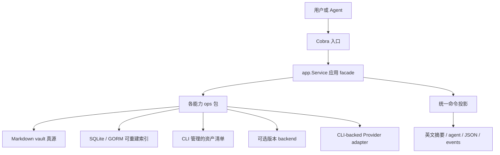

# 架构边界



`cmd/pinax` 只装配命令、参数、校验与输出模式；`internal/cli` 构建 Cobra 命令，只调用 `internal/app`，不能越过 facade 直接依赖 ops 包。`app.Service` 保留构造、公共依赖、兼容 glue 以及 CLI 直接使用的请求/响应类型。

新增或迁移的业务规则进入 `internal/app/*ops`。稳定模型归 domain，渲染归 output，秘密、token、原始载荷与 trace 脱敏归 redaction。持久化通过 adapter/repository；关系访问默认使用 GORM。

`internal/version` 只提供能力驱动的版本证据，用户入口是 `pinax version`；Git 是可选 backend 或隐藏兼容别名。`internal/assets` 管理 vault 文件事实与 CLI 生成的 manifest，manifest 不是二进制 payload 的真源。

<a id="app-capability-packages"></a>
## 应用能力包

| 包 | 命令族 | 职责 | 禁止依赖与行为 | 针对性测试 |
| --- | --- | --- | --- | --- |
| `internal/app/noteops` | note, folder, metadata, import, export, attachment | 笔记 CRUD、metadata、标签、目录、导入导出与附件。 | 禁止导入 CLI/output 或直接写 stdout/stderr；不处理 Provider token。 | `go test ./internal/app ./cmd/pinax -run 'Note|Folder|Metadata|Import|Export|Attachment|Record'` |
| `internal/app/knowledgeops` | knowledge export-projection | 双条件 allowlist、有界 refs 投影、墓碑撤销和 digest 差异选择。 | 禁止导入 CLI/output 或直接写 stdout/stderr；不处理 Provider token、不接外部检索、不写 vault/index。 | `go test ./internal/app/knowledgeops ./internal/app ./cmd/pinax -run 'Knowledge'` |
| `internal/app/searchops` | list, search, query, database views | 列表、搜索、查询与数据库视图的应用编排。 | 禁止导入 CLI/output 或直接写 stdout/stderr；不解析 Cobra、不直接调用 renderer。 | `go test ./internal/app ./internal/index ./cmd/pinax -run 'Search|Query|Database|List'` |
| `internal/app/vaultops` | init, validate, project, storage, stats, doctor, repair, organize | vault 初始化、校验、维护、修复计划与应用、整理。 | 禁止导入 CLI/output 或直接写 stdout/stderr；不拥有云同步协议、不直接渲染。 | `go test ./internal/app ./cmd/pinax -run 'Vault|Init|Validate|Project|Storage|Stats|Doctor|Repair|Organize'` |
| `internal/app/templateops` | template, journal, render run, index page | 模板解析、日志创建、渲染与索引页。 | 禁止导入 CLI/output 或直接写 stdout/stderr；不实现版本 backend。 | `go test ./internal/app ./internal/templateengine ./cmd/pinax ./tests/e2e -run 'Template|Journal|Render|IndexPage'` |
| `internal/app/syncops` | cloud, sync, backend, conflict, sync log | 同步 push/pull/diff、backend 协调、日志与冲突。 | 禁止导入 CLI/output 或直接写 stdout/stderr；测试不使用真实凭据。 | `go test ./internal/app ./internal/cloudsync ./internal/cloudclient ./cmd/pinax ./tests/e2e -run 'Cloud|Sync|Conflict|Backend|Redaction'` |
| `internal/app/versionops` | version, record history | 版本用例与 facade 返回值。 | 禁止导入 CLI/output 或直接写 stdout/stderr；不在命令代码解析 Git porcelain、不直接调用 renderer。 | `go test ./internal/app ./internal/version ./cmd/pinax -run 'Version|Record|History|Rollback'` |
| `internal/app/briefingops` | briefing, provider-backed research summary | 调研摘要、Provider adapter 调度、脱敏证据交接。 | 禁止导入 CLI/output 或直接写 stdout/stderr；不输出 Provider 原文、不保存 token。 | `go test ./internal/app ./cmd/pinax -run 'Briefing|Provider|Research|Redaction'` |
| `internal/app/planningops` | plan, planning workflows | 计划工作流、状态迁移和返回投影。 | 禁止导入 CLI/output 或直接写 stdout/stderr；不接管根 OpenSpec 治理。 | `go test ./internal/app ./cmd/pinax -run 'Plan|Planning|Task|Decision'` |

每个能力包的 `doc.go` 声明相同的归属字段；架构检查验证文档声明和 import 边界。

<a id="current-facade-extractions"></a>
## 当前已抽出的规则

- noteops：列表 predicate 与标签/日期过滤。
- knowledgeops：双条件 allowlist、refs-only 投影、墓碑与 digest 差异。
- searchops：请求校验、结果整形、链接目标与 fallback 过滤、Pinax SQL 解析/执行辅助。
- vaultops：统计聚合与索引新鲜度分类。
- templateops：查询结果的 Markdown 渲染。
- syncops：路径 policy 规范化、计划脱敏与云同步字符串清理。
- versionops：vault 相对版本对象路径校验。
- briefingops：recipe 投影整形。
- planningops：周期解析、容量风险、preview 提取与 Pinax action draft。

新用例先扩展所属能力包，再由 facade 暴露兼容方法。已有 facade 可保留 IO、持久化、event append 和兼容装配；纯规则与投影整形逐步进入能力包。

<a id="architecture-guard"></a>
## 架构验证

```bash
go test ./internal/architecture
```

检查 CLI/cmd 不直接导入 ops、ops 不导入 CLI/output，以及每个必需能力包的 `doc.go` 是否声明命令族、职责、禁止依赖和测试入口。以真实依赖边界为准，不添加文件行数硬门槛。

<a id="relationship-graph-boundaries"></a>
## 关系图边界

Markdown vault 是双向关系真源；SQLite/GORM 的 LinkRecord 等只是可重建投影。vault 内资产文件保存真实字节，manifest 保存相对路径、hash、媒体与链接事实。版本 backend 负责 snapshot、revision、changed paths 和 restore plan，不接管正文、资产字节、record ledger 或索引。

note links/backlinks/orphans、search --link-target、doctor、repair、organize、dashboard 和 MCP 复用应用服务的解析与目标定位，不各写一套 parser。

`broken`、`ambiguous`、`orphan`、`asset_missing`、`asset_hash_changed`、`link_resolution`、`link_rewrite` 只进入人工审阅计划。dry-run 和只读 MCP 不写 Markdown、.pinax、版本 backend、Provider 或远端状态。MCP 只返回有界事实、候选摘要和真实下一步命令，例如 `pinax note links <ref> --vault <vault> --json`，不返回完整正文。
