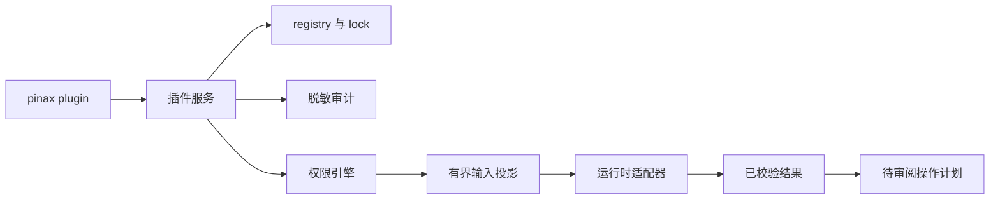

# 插件运行时架构

Pinax 动态插件由 manifest 描述、权限限定并通过独立 runner 执行。Markdown vault 始终是真源；插件只计算有界投影或可审阅操作计划。

## 边界

- `.pinax/plugins/registry.json`、`plugin-lock.json`、`.pinax/events/plugin-audit.jsonl` 及权限 grant 只由 `pinax plugin` 服务写入。
- 输入使用 `pinax.plugin.call.v1`，输出使用 `pinax.plugin.result.v1`。
- WASM 默认不能访问网络、环境变量和宿主文件系统。
- JavaScript、Python 和 process runner 是明确受信任的外部程序：stdin 接收输入，在 Pinax 管理的临时目录工作，只接收最小环境。
- 插件不能直接写 vault；写操作必须返回 action plan，再经过已有批准与快照流程。

## 当前实现状态

manifest 校验与秘密拒绝、registry/lock/audit、启停、卸载、权限授予与撤销已实现。WASM 的调用、结果、预算和沙箱合同由 fake adapter 验证，真实 WASM 引擎仍可在同一合同后接入，不能把 fixture 当成实际引擎。

JS/Python/process runner 合同已实现可执行文件探测和受限环境。`plugin run` 是 dry-run/read-only；无法执行时返回 `plugin_disabled`、`plugin_permission_denied`、`plugin_runner_unavailable` 等稳定错误。

## 凭据与维护

真实凭据不能进入 manifest、registry、lock、audit、文档、fixture、stdout/stderr 或证据。使用用户级秘密存储、本地用户配置，或 CI/临时环境变量。

不要手改插件 JSON 和审计事件。使用 `pinax plugin install`、`pinax plugin permissions grant`、`pinax plugin disable`、`pinax plugin uninstall`。
