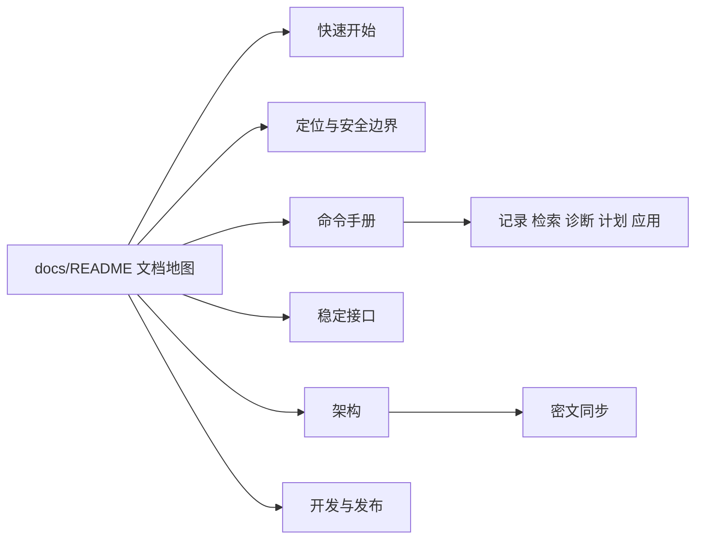

# Pinax 文档设计

文档帮助人类和 Agent 理解、操作本地知识闭环，始终说清三件事：Markdown vault 是真源；写入受 Proof Loop 保护；同步是传输表面，Cloud Sync 只协调密文。

## 阅读路径

| 读者 | 首个入口 | 下一步 |
| --- | --- | --- |
| 新用户 | [快速开始](../quickstart.md) | [命令手册](../commands/README.md)，完成记录、预览、计划、快照、应用与恢复 |
| Agent 集成者 | [安全边界](agent-safe-boundary.md) | [输出合同](../interfaces/cli-output-contract.md)、[REST/RPC 合同](../interfaces/remote-api-contract.md) |
| 开发者 | [架构边界](../architecture/architecture-boundaries.md) | [本地开发](../operations/local-development.md) 与 owner OpenSpec |
| 运维与发布 | [发布打包](../operations/release-packaging.md) | 验证与打包不自动发布 |
| 同步审阅者 | [同步设计](../architecture/cloud-sync-design.md) | 核对无明文、无远端执行不变量 |

## 文档关系

## 内容归属

`docs/README.md` 与保留的语言入口只导航，不重复整本命令手册。quickstart 给出一条短路径；overview 解释定位、安全和文档设计；commands 按工作流和命令族说明用途、写入边界和例子；interfaces 维护 CLI/API、auth/cache 和输出合同；architecture 解释模块、同步和关键决策；operations 维护开发、打包与验证步骤。实施任务、证据和归档属于 OpenSpec，稳定说明在 closeout 后进入对应文档。

## 一致的产品解释

Pinax 是 Markdown vault 的 Agent 安全知识控制平面。正文、SQLite/GORM 投影、版本证据、CLI 生成元数据与本地工具执行留在本地；Agent 默认只看有界投影。写入经过 `plan → snapshot → apply → receipt → restore`。Cloud Sync 不替代 vault，不保存笔记明文，不在服务器执行本地工具。

不要把某个发布、插件、日报、Web 编辑或 Provider 表面描述为另一个独立产品，也不要把规划中的团队协作说成已实现。

## 命令页写法

依次说明用途、可直接运行的命令、读写与远端副作用、支持的输出模式、相关链接。新命令从命令手册可发现；不显示内部执行前缀。

## 语言与合同

活跃开发、设计与维护说明以中文为主；公开英文命令参考可以保留，不额外复制整套目录。命令、flag、JSON key、event type、错误码、Provider ID、schema、路径与术语保持稳定。

禁止在文档、fixture、receipt 与解释中写入原始提示词、隐藏提示词、Provider payload、未脱敏 token、Authorization、Cookie、webhook URL 或完整推理。`.pinax` 配置、回执、事件和同步映射由 CLI 创建与更新，文档给出对应命令，不教用户手写机器状态。

## 维护方式

每项内容只有一个 owner；输出、RPC、auth、cache 与事件变化更新 interfaces，架构与存储决策更新 architecture/overview。根仓只保留跨项目导航，不复制产品说明。文档改动检查相关链接和锚点即可；代码改动验证对应行为，最终稳定时再按需运行完整检查。
