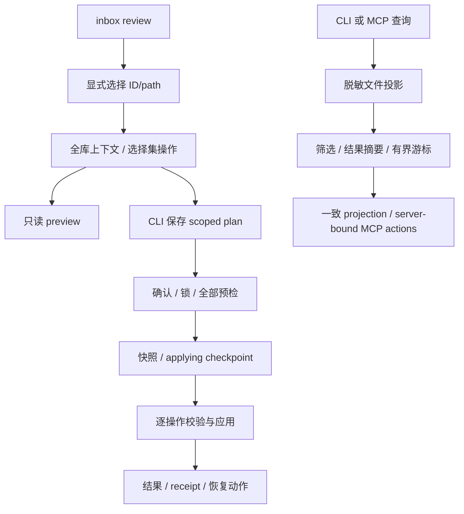

# 日常闭环实施设计

## 范围与合同

限定本地单 writer，保留已有脏工作树。工作区使用当前 checkout，因为 Pinax 是短生命周期 CLI，测试仅使用临时 HOME/vault；无常驻后台资源。两个能力均 experimental，根产品和 11 项真实验收任务不变。

## 选择集整理

`--note` 可重复，ID 或 vault-relative 文件路径；不接受标题，最多 20 个唯一 canonical 对象。重复 selector 去重，重复身份、未知/系统/归档/丢弃对象整次拒绝。先计算全库候选与关系再限制写入对象，避免批外链接误判。不猜测目录，不增加自动分类。

新 `pinax.organize_plan.scoped.v1` 复用 OrganizePlan，增加 selection（对象、原路径、revision）、snapshot_id、operation_results。旧 schema 只走旧路径，旧 CLI 拒绝新 schema。只读预览不写文件；--save 由 service 创建计划，所有操作必须绑定选择集。无操作的选择对象也必须保存并复验。

apply 必须 --yes 和保存计划。scoped 禁止 --allow-stale，整批校验身份、路径、revision、有效期、目标占用与冲突；无关正文修改不阻塞。获得现有 operation lock 后复验，保存真实 snapshot ID 和 applying 后开始写。移动采用同文件系统 hard-link/unlink，不支持则 fail closed，不能覆盖目标。状态 planned→applying→applied|partial|failed；中断 applying 或任何终态都不可自动重跑。可预测预检失败不修改笔记，执行中失败停止并报告已完成/失败/未处理，receipt 失败明确 evidence incomplete。恢复不自动覆盖后续编辑，复用 pipeline/version 工作流。

## 提案读取

list 的 status/kind 单值精确匹配，limit 默认 50、范围 1–50。排序 created_at DESC / proposal_id ASC；旧 data 数组与 count/limit/truncated 保持，新增 total/remaining/has_more/next_cursor。游标版本化 Base64URL，最大 2 KiB，绑定 vault、参数、结果集摘要和位置；错误返回 proposal_cursor_invalid，匹配集变化返回 proposal_cursor_stale。审批后重新第一页。

读取只使用既有脱敏投影，不打开 SQLite、不创建 sidecar。show 直接校验原 ID 文件；列表损坏不静默忽略。CLI 下一步绑定同一 vault 并 quote；不能以错误恢复之名生成重新 propose/apply。MCP 增加可选筛选和 note_refs，返回工具名/参数的只读动作，owner 执行动作明确位置但不输出服务器路径。proposal_id 与分页参数互斥。没有新写工具或权限字段。远程不支持则明确拒绝。

## 兼容与回退

所有改变 additive，旧默认/全库路径和 schema 原样保留，无 deprecation 或 DB migration。旧二进制不能执行 scoped 格式，不提供降级转换。复用已有 Go 库、GORM（仅原写路径）与 testscript；不引入依赖或持久分页系统。只读失败和 partial receipt 不虚报成功。

## 验证

聚焦 app/CLI/MCP 单元和 command tests，testscript 覆盖小批选中→保存→审批→恢复、多页提案及多 vault 动作。故障注入覆盖漂移、冲突、投影损坏、执行部分失败、receipt 失败与只读文件树指纹。新 evidence profile 为 daily-review-followthrough；最终再运行 agent-note-proposal、rendered-view-parity、daily-knowledge、daily-knowledge-quality（包含 task check）与 strict OpenSpec。成功失败均保存标准脱敏证据，不运行 race。源技能只定向同步，既有 Aigora profile 缺失不由本次修改。
