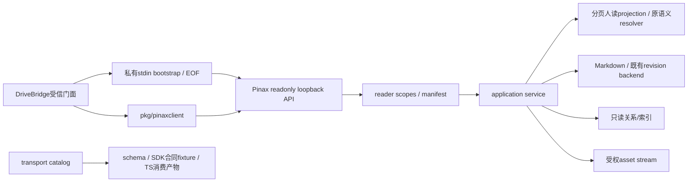

## Context

2026-10-01用户确认DriveBridge内置知识空间、Electron三平台、阅读先行。Pinax继续headless领域owner。P01–P09 已实现全部只读端点、typed client、受监督会话并通过 component 证据；binding 自 P06 起 available。

## Goals / Non-Goals

提供有明确正文授权、完整但有界分页、固定revision与安全资产通道的人类阅读合同。保留旧Agent投影和远端RPC。非目标：客户端、阅读状态、云后端、多租户reader、Hermes部署、新同步或任意filesystem API。

## Decisions

1. reader是新增资源族，默认不开；scope由owner授予而非audience字段推导。旧Agent card/context/body、SafeText及预算原样保留。
2. 复用application解析/版本/关系/asset语义，新人读projection允许原文代码和路径，禁止执行HTML与获取隐藏/private资源。handler只适配，不直接访问Markdown/SQL。
3. 列表默认50/max200；正文每页256KiB/512节点、1MiB响应、8MiB源与65536节点总预算；continuation保证大块/UTF-8边界。超预算明确拒绝交互全文并提供显式source stream，不静默截断。
4. 固定revision分页，不自动snapshot。旧版不可达时明确409；cursor绑定会话/权限/索引代次。资产按opaque ref+note/revision验权，Range有界。
5. 新reader no-store且日志不含内容/query，旧cache合同不变。只读命令不refresh/index/rebuild/迁移/同步。
6. 新session-stdin opt-in引导固定readonly loopback；secret在私有管道/内存，无argv/env/日志。EOF排空并CloseAll，不留daemon、不抢其他进程。
7. binding_id是消费者本机登记的非秘密句柄，不新增vaultUUID迁移或把sync workspace误当本地identity；原URI不改变。

具体路由、类型、错误、预算和引导字段唯一真源是[人类阅读合同](../../../docs/interfaces/human-reading-api.md)，不另手工维护OpenAPI。

## Architecture

## Tasks and boundaries

P01 CONTRACT冻结并生成合同/fixture与漂移门，复用工具同时登记后续证据profile。P02–P06 BACKEND分别负责scope/list/search、document、relations/assets/source、supervised生命周期、SDK/manifest兼容。P07 INTEGRATION已用合成vault跑通Pinax component/testscript，不调用DriveBridge UI。P08稳定质量门与文档已交付，P09 CONTRACT已创建后续受控写 owner change（pinax-human-reading-write-v1），不实现写入。

每任务单PHASE/单writer，前端真实消费记INTEGRATION_PENDING，DriveBridgeD09接续。Pinax后端实现按本owner流程隔离disposable数据/端口/log，不操作日常vault。当前仅文档无需服务/worktree。

## Compatibility and rollback

新路由/flag/schema为additive；旧read/list/RPC/MCP/URI及cache输出不改。机器资产由owner生成器维护；新reader未实现时manifest不能显示available。关闭reader/revoke会话可回退，无真实数据迁移，无自动降级到私有文件。新的秘密引导禁止复用旧temp-token日志解析，普通temp-token模式既有行为不在本包修改。

不解除旧continuity窗口或memory owner准入，原5个change的11个真实任务保持。新fixture、schema和strict只证明各自层级，不标三平台、自然使用或生产ready。

## Validation

实现期复用Go testing/httptest、testscript、integrationevidence：human-reading-{access,document,resources,session,client,api,quality} 七个 profile 全部跑通（证据见 tasks.md 各 evidence）。跨vault/权限/旧合同/长文/坏asset/EOF/续读终止性与并发CLI均已覆盖，禁止race/真实model/真实sync。component/e2e六件套写本owner temp，失败保留原退出码；quality profile 包装 task check（无 race 阶段）。
