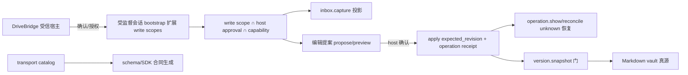

## Context

pinax-human-reading-api-v1 已交付只读人读面（P01–P08：合同冻结、七端点、typed client、受监督会话、component 证据与质量门）。DriveBridge 阅读空间的下一步是受控写：捕获、编辑、整理。写入门在 Pinax 既有体系里已经存在——approval/write scope、expected_revision、snapshot_required、operation/receipt、unknown 恢复——本 change 只把它们投影到人类会话合同上，不发明第二套写入门。

## 能力与 HTTP 缺口审计（唯一输入）

### 既有 application 能力（按面分组）

| 组 | 能力 | 已有面 | 写入门 |
| --- | --- | --- | --- |
| 捕获 | inbox.capture | REST/RPC/CLI | approval + operation id/idempotency（X-Pinax-Operation-ID、Idempotency-Key） |
| 捕获 | draft.create | REST/RPC/CLI | approval（yes） |
| 捕获 | note.add、journal.daily.append、import.markdown | 仅 CLI（cli-proof-loop） | 本地 CLI 门 |
| 提案/评审 | agent note proposals（propose→review→apply） | CLI/RPC（agent runtime） | approval + proposal receipt，reconcile 路径完整 |
| 提案/评审 | MCP collaboration preview/apply | MCP 工具 | change+preview_digest+authorization 断言，host approval，无自批 |
| 结构写 | folder.create/rename/move/delete/adopt | REST/RPC/CLI | approval；rename 另有 expected_revision + snapshot_required + operation/receipt |
| 整理 | organize.plan/apply、repair.plan/apply | plan: CLI/MCP；apply: 仅 CLI | approval_and_snapshot + plan id |
| 版本 | version.snapshot/restore | 仅 CLI | 写门 + revision |
| 同步 | sync.push/pull | CLI/RPC | approval + revision conflict |
| 恢复 | operation.show、operation.reconcile | REST/RPC/CLI | 只读/reconcile_only |

### 人类会话视角的 HTTP 缺口

1. **捕获缺口**：reader 会话没有捕获入口——inbox.capture 的 REST 面依赖旧 token scope，不能直接给 human-reader 会话复用；需要 reader 相邻的 write scope 投影。
2. **编辑缺口**：没有"编辑提案→预览→确认→应用"的 HTTP 面；MCP preview/apply 与 agent note proposal 的语义最接近，但都不在人类会话授权模型内。
3. **整理缺口**：organize.apply 无 HTTP 面；plan/apply 的 approval_and_snapshot 门需要映射到 host 确认流。
4. **无缺口项**：operation.show/reconcile、folder 结构写、sync —— 已有 REST/RPC 合同，本 change 不复制；如人类会话需要，按 scope 投影引用既有合同即可。

## Goals / Non-Goals

目标：冻结受控写的人类会话合同——独立 write scopes、host 评审、snapshot/revision 门、operation receipt 与 unknown 恢复——并按 W02–W07 交付实现：捕获/编辑/整理投影、typed client 与组件证据（W06 后五个 writer binding available）。

非目标：合同冻结期（W01）不实现任何端点，manifest/OpenAPI 不出现写 binding available；实现阶段（W02–W06）只经由本 change 冻结的五个 binding 交付写路由。不改动既有 inbox/draft/folder/memory/proposal/sync 合同；不新增 MCP 自批；不提供普通文件覆盖旁路；不做收藏/进度/阅读状态。

## Decisions

1. **write scope 与 reader scope 同构但独立**：新增 `writer.capture|editor|organizer` 类 owner 授予 scope，进受监督会话 bootstrap 的 allowlist 扩展位；audience/请求字段永不升权，旧 read/write/admin token 不自动获得。
2. **一切编辑走提案**：人类编辑以 proposal（change + preview_digest）为唯一入口；apply 只接受未变更的 preview，host approval 由宿主显式给出——authorization 是调用方断言，不是已验证批准；沿用 MCP collaboration 与 agent note proposal 的既有语义，不在 HTTP 上放宽。
3. **结构写复用既有合同**：folder/inbox 等结构写不在本合同内复制；如人类会话需要，引用既有 REST/RPC capability 并以 write scope 投影授权。
4. **revision/snapshot/operation 语义不降级**：apply 携带 expected_revision；变更冲突 409；snapshot_required 能力必须先建快照（或显式声明免快照理由）；每个 apply 发 operation receipt，unknown 走 operation.show/reconcile 恢复，禁止换 identity 盲重试。
5. **失败与恢复**：网络/宿主崩溃后客户端带同一 operation identity 查询恢复；receipt 缺失不等于失败，也不等于成功；不做自动补偿写。
6. **首片只读不变**：合同冻结期（W01）不新增任何可写路由，manifest/OpenAPI 不出现写 binding；实现阶段（W02–W06）仅经由本 change 冻结的五个 binding 交付写路由，W06 组件证据后 available。

## Architecture



## Tasks and boundaries

W01 CONTRACT 冻结写合同 schema/scope 枚举/错误表；W02 BACKEND capture 投影；W03 BACKEND proposal/preview/apply；W04 BACKEND organize 投影；W05 CLIENT typed write calls + receipt 轮询；W06 INTEGRATION component 全链（含崩溃恢复）；W07 QUALITY 稳定门与交接。每任务单 lane、同路径单 writer，验证复用 integrationevidence 新增 `human-reading-write-*` profiles；实现期禁止 race/真实 vault/model/sync。

## Compatibility and rollback

全部 additive：reader 只读面不动；旧 REST/RPC/MCP/URI 合同不动。撤销 write scope 或关闭 write capability 即回退到纯只读会话；无数据迁移。若 apply 半途失败，恢复路径只有 operation receipt 与既有 reconcile，不存在文件覆盖补救。

## Validation

本 change（合同片）验证：

```bash
openspec validate pinax-human-reading-write-v1 --strict --no-interactive
```

能力追溯：本文件审计表为后续任务范围的唯一来源；实现任务不得超出审计出的缺口项，也不得复制"无缺口项"。
