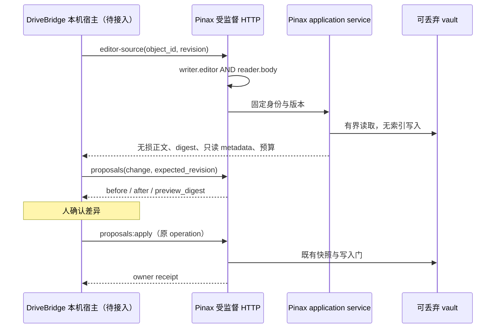

## 背景与边界

本变更分为 CONTRACT、BACKEND；消费端 FRONTEND 与 INTEGRATION 属于 DriveBridge。编辑源码能力为 `fit`（Pinax 拥有正文、身份、revision、提案和回执）；Electron、UI、受管范围 guard 为 `split-owner`，归 DriveBridge。直接在 renderer 访问 vault、通过普通文件 API 写 Pinax 对象为 `reject-now`。

## 宿主私有会话合同复用（N05.1）

`pkg/localsession` 作为Pinax公开host protocol包，提供既有Bootstrap/Event类型；internal/api保留原名字alias，字段/JSON tag/HasWriterScope语义不变，catalog schema及HTTP/OpenAPI不改。公开类型与owner schema及writer allowlist有一致性测试。新DecodeReady仅供宿主严格验证，帧最多16KiB，拒绝尾随JSON/重复字段/大小写伪装/null/未知或error字段；比较原nonce/binding/manifest digest/readonly并限制为固定127.0.0.1非零端口origin。不负责进程启动，不自动升权，不输出原始错误。

既有human-reading-session evidence profile复用，加入公开包；真实CLI e2e改为直接消费公共Bootstrap和原始ready帧，去掉重复SessionEventJSON结构，失败路径关闭管道及回收自有进程。ready兼容检查采用同一测试编译binary的 `api manifest --json` 输出，不从事件自证digest。两次introduced测试错误保留：`20261005T101713Z-3072793`用了未构建命令树的内部manifest导致摘要不一致；`20261005T101823Z-3148223`错误假定status=ok，实际CLI协议为success。最终profile `20261005T101914Z-3198311`通过，含真实子进程ready/授权GET/EOF退出和公开schema/负例；其中app/cli/cmd三包no-tests仅编译，不算额外测试。profile构造测试和公开包vet通过。

此切片是CONTRACT，不宣称DriveBridge已启动Pinax或guard已准入；消费者进程管理与可信binary校验归DriveBridge D02。保持当前dirty owner工作区单writer；只临时合成vault，不调用个人数据或race。

## N05.2 reader索引检查不修改源vault

DriveBridge真实metadata纵切发现mode=ro依然在源vault生成空WAL和SHM，旧单测仅拒非空WAL，未满足源树不变。修复在Pinax owner：`internal/sqlitedsn/OpenReadSnapshot`复制main与可选WAL到0700临时目录/0600文件，合计64MiB上限；前后两次有界读取比较身份/长度/mtime/摘要，变化即拒绝。拒绝非普通文件、symlink、缺主库、超预算及rollback journal；不复制SHM，不对源做checkpoint/delete，不把活库设immutable。GORM仍经统一OpenReadOnly打开私有副本；返回cleanup关闭池并移除副本。仅InspectReadOnly使用此路径，其他通用读写DSN不变。

这是保守诊断快照，不是锁定活库事务，活跃writer下可能返回index_unavailable；每请求最多两遍64MiB读并复制，暂不缓存。进程被强杀可能留下操作系统临时目录，需要后续有界残留清理，不声称具备加密擦除；源vault始终不做清理。重复检查不积累连接池。测试强化为源WAL/SHM均不得新建，新增关闭库与有提交WAL读取、写入拒绝、源字节不变、预算/目录/journal/symlink负例。

owner证据：human-reading-session `20261005T104255Z-252866`（新增index/sqlitedsn过滤），human-reading-access `20261005T104123Z-177479`；定向vet通过。消费方D02.3真实Go→Pinax process→metadata+拒body→EOF/取消→原vault树字节不变在DriveBridge `20261005T104313Z-dbb108ee`通过。不宣称Electron或guard授权通过。

## N04.13 日记编辑SDK与真实丢回执恢复

pkg/pinaxclient/writer_daily_edit.go新增typed source/propose/apply。source复用提取decodeWriterEditorSource（普通入口校验不变），额外核command/kind daily；proposal核closed schema、日期/时区/对象/原operation/expected rev、safe relative .md path、after==requested body==change.body、UTF8无NUL与64KiB字节；apply128KiB JSON、无自动重发，歧义携原operation unknown。成功receipt校writer.daily.edit/rest.writer.daily.edit、外层HMAC request_digest、revision_before、原ID/path/content_digest/record_digest、snapshot及原record事件receipt，正常resource_ref改为objectID与reconcile一致，仅daily专属不改旧writer。

真实client创建daily→source→proposal→owner apply成功后代理丢返回503→unknown原ID且只一次请求→显式相同proposal返回完全相同receipt→新revision source原样回读/旧revision拒。不是mock成功回执，代理实际调用owner handler提交。替身正控制与wrong ID/body/path/action/extra、错digest（特意用内部preview摘要）/resource/content/missing proof拒；超UTF8字节request不出网，每apply一次请求。这里客户端不能验证HMAC或独立重新证明record真伪，只验证来自owner的合同与身份一致性。

notebook-daily20261006T020617Z-238970七包、普通editor020621Z-243617五包passed六件套；vet app/client、diff过，LSP4inconclusive。初SDK020436Z-154938通过后强化record proof校验。API文档同步，旧OpenAPI/schema没有新增字段。跨session恢复、D03安全隔离及全站/实机仍未完成，无race/真实vault/commit。

## N03.5 / N04.12 日记编辑闭合同与HTTP

新增writer_daily_edit schema四项：daily_editor_source.request、daily_edit_propose.request、daily_edit_proposal、daily_edit_apply.request；response source/receipt复用原schema，内部preview嵌closed replace-only change（空body可省略），外层独立schema_version与HMAC preview_digest，不扩原writer change枚举。Go proposal增加JSON tags/schema字段进入HMAC，同版本服务产生/验证；未发布旧内存提案不跨升级回放。新增三个available REST binding，三scope，source GET8KiB闭query、提案/apply POST128KiB闭JSON；正常化error表含revision_conflict/frontmatter_unsupported/note_identity_ambiguous等，no-store。typed client未在本片实现。

真实TestWriterDailyEditHTTP创建日记→source→exact diff→确认apply→同receipt重放→新revision source；日期篡改HMAC409、旧source409、重复query400、unknown写字段400、每项scope缺失403、撤权401。回执request_digest核外层HMAC。最终notebook-daily20261006T015715Z-3970939七包passed六件套；首红015546Z-3897443仅expected writer数8→11与OpenAPI旧golden需登记。现新增3path/4schema后digest6f173eb3…，删除新增项恢复43c4c9cf…及所有旧分层摘要；保旧测试不改义。vet app/api/catalog/diff过LSP1clean4inconclusive，人类写API文档同步。

尚无日记编辑SDK/真实丢返回测试；完整source/JSON超限矩阵与跨session仍需后续，不冒已全验。既有check→rename外部竞争与D03不因HTTP开放而解决，DriveBridge未被授权成功binding，三平台未验，无race/真实vault/commit。

## N04.11 日记编辑中断的固定证据恢复

日记编辑原写链在实际replacement前checkpoint原note_id/path、完整预期source SHA256与原record内容摘要，不存正文。private beforeWrite回调仅writer.daily.edit启用，checkpoint失败不替换文件；失败outcome保这些预备事实，正常完成也保留摘要。保存后再读revision若非预期source digest则unknown，不拿外部变化版本冒自己的保存结果。旧通用writer结果格式不变。

新增dailyEditReconcileEvidence接OperationReconcile既有锁：检查metadata路径、固定原文件≤64KiB/current digest/ID/kind daily，查原operation ID对应NoteMetadataUpdated event，核path/ID/原record digest；同时匹配才生成原operation恢复receipt。不创建/修改正文、不append record、不重建索引。缺预备事实、缺record、目标变更或证据冲突保持reconcile_required。record摘要来自写入前实际正文语义（保首尾空白），不能用归一化parser body反算替代。不是证据不全时自动执行，未扩跨session查询授权。

notebook-daily20261006T014619Z-3437924七包passed，新增六类合成持久中断record/no-record/changed/wrong-record/wrong-id/missing-proof，只有完整匹配成功，恢复前后源bytes及record数量不变、原apply回放不重新写。真实成功apply测试也核持久摘要与实际新revision/正文语义一致，避免仅手造fixture证明。该中断矩阵是确定性状态构造，不冒进程强杀或全部真实I/O故障。普通editor回归014633Z-3451203五包passed；vet app/diff过LSP2clean3inconclusive。初定向014440Z-3356582也过，six件套齐。外部writer最终检查→rename窗口、跨平台原子性、公开edit HTTP/client与D03仍未解决，无race/真实vault/commit。

## N04.10 日记替换正文提案与原回执应用服务

新增WriterDailyEditPropose/Apply（仅application，暂无HTTP/schema/client）。三scope、原operation/date/timezone/object ID/revision；只读源码与navigation扫描构造CollaborationPreview同格式exact before/after和canonical change digest，不调用可能打开可写索引的mutable resolver。额外HMAC绑定vault/session/binding/scopes/date/ID/完整preview；任一改动拒绝。完整source≤64KiB，proposal JSON预留envelope预算（128KiB减1KiB），特殊frontmatter不能无损拆分则拒绝。正文和完整提案仅内存，ledger只原identity/digest/结果与receipt。

原collaborationApplyWithRequest委托private collaborationApplyGuarded；普通路径nil guard不改行为。日记路径在原vault operation lock内、replay之后首次核日期/对象/源码，在snapshot之后最终atomicWriteFile前再次核原source digest/path/ID/date，且检查含updated_at更新的完整source预算。复用原快照、operation ledger、atomicWriteFile、record/index及original receipt，不造第二保存引擎。capability writer.daily.edit隔离旧writer.apply；原session及HMAC有效时终态回放返回原receipt，外部正文变更不导致换key重写。OperationReconcile对此capability也先取得vault锁，未完成证据仍unknown，无自动重试。成功记录中的路径沿既有owner局部结果，不进入renderer。

不是跨所有外部writer的文件系统CAS：普通atomicWriteFile仍是最后观察后rename，未证明外部编辑器在检查与rename之间的所有交错、祖先替换或不同CLI锁协议。该限制不因private guard而消失，也不满足DriveBridge D03；本片不开放HTTP或绑定。强杀/提交后record失败的edit专用reconcile证据尚未实现，unknown保守保留，跨session恢复后续。

notebook-daily20261006T013747Z-3003049七包passed：真实daily创建→编辑proposal→人工assertion apply→exact正文/ID/kind/title/tags保留→新Service原receipt回放，原ledger无body；proposal前后全树文件hash/目录/sidecars不变。tampered body/date/session/授权/事前外改拒；snapshot hook外改保持外部正文并原operation reconcile_required；snapshot期间reconcile被锁拒且apply完成。notebook-editor-source013801Z-3015576五包普通editor/writer/client回归通过；vet app/diff过LSP2clean2inconclusive。初实现日记profile013501Z-2869086亦通过，后续增加只读提案与reconcile锁证明。六件套齐全，无race/真实vault/commit。日记公开编辑合同与真实HTTP/client仍未交付，父任务未关闭。

## N04.9 日记无损编辑源码应用服务

新增WriterDailyEditorSource（尚无HTTP/client），独立date/timezone+Source固定ID/revision，要求writer.editor/reader.body/reader.metadata三scope。ReaderDaily读取前后复核原对象、revision和watermark；private writerEditorSourceSelected仅供owner传选择策略，通用WriterEditorSource保原system index/journal拒绝，日记入口只接受kind=daily。没有公共allow_system参数或通用写入规则改变。复用原os.Root有界原文件读取/身份去重/UTF8无NUL/64KiB完整source/无损body与protected metadata白名单，不由AST/导出重建。

返回editable沿原义仅说明frontmatter与body可无损分离，不证明日记apply已可用；普通提案/保存路径未升级，后续独立日期约束与原operation gate必需。源码服务本身不生成proposal/operation，不写索引或snapshot。特殊frontmatter仍原readonly策略。

notebook-editor-source 20261006T012926Z-2597959五包passed/六件套：新增当前daily与legacy notes/daily原始正文空白/CRLF/分隔符保持、三个scope分别缺失拒、日期/ID/revision漂移拒、64KiB完整source预算、合法空body、非daily/重复ID拒、普通system入口拒、无.pinax创建及原源不变；原普通editor/writer/client回归通过。vet app/diff过，LSP1clean2inconclusive。HTTP/day编辑propose/apply仍后续，D03与DriveBridge INTEGRATION_PENDING，无race/真实vault/commit。

## N04.8 日记预算事实与客户端反例正控制

新增api/reader_daily_document_test.go三组真实HTTP：短控制字符代码正文200；200000个控制字符先证明application成功但JSON转义超过1MiB，HTTP413 document_budget_exceeded；8MiB+1源正文413 document_too_large。两错误均保原revision/source_size_bytes、无actions/正文nodes、不初始化vault或改源。无生产预算调整。

首红20261006T012228Z-2259796查出N04.6预算error projection.Command仍reader.document，writeReaderProjection因command不匹配重建错误导致Facts丢失；最小修复将错误分支Command设reader.daily.document，保清Actions。另查出N04.7客户端替身误用schema_version而非spec_version，旧负例在envelope解析层即拒，不能证明identity分支。现用ProjectionSpecVersion正确envelope加valid正控制，随后分别改变ID/rev/currentrev/URI/extra证明真实校验，invalid request仍零额外HTTP。N04.7真实server成功链不受该测试缺陷影响。

最终notebook-navigation20261006T012409Z-2341112五包passed/六件套，vet app/api/client、diff通过，LSP1clean2inconclusive；旧失败保留。此片不开放日记编辑/DriveBridge绑定，无race/真实vault/commit。

## N03.4 / N04.7 日记正文公开只读端点

独立GET /v1/reader/journals/daily/document：catalog capability reader.daily.document显式body暴露与readonly，新增closed request schema固定date/timezone/object_id/sha256 revision、可选cursor/anchor/outline_cursor，response复用旧document schema。HTTP复用readerNavigationQuery（8KiB query、未知/重复/坏转义拒绝），两scope分别校验，成功data.document；完整JSON封包1MiB，超预算413不生成source-export日记旁路，no-store。typed client先校request schema、互斥分页字段，再验证document schema/原ID/rev/current rev/URI，不从本地文件补读取。原reader/写入协议无改义。

notebook-navigation 20261006T011744Z-2026636五包passed：新client真实server分页、metadata/body单scope403、匿名401、POST405、闭query400、外部改版拒、撤权拒、无.pinax初始化；替身malformed identity/revision/URI/未知字段拒，非法revision未发请求。OpenAPI新增摘要43c4c9cf…，删除新path/request schema精确恢复82603700…及更早逐层基线。首红011648Z-1980293仅catalog旧10个expectedRoutes漏新入口，补准确第11项后通过；未删旧合同断言。vet api/app/catalog/client和diff通过，LSP1clean4inconclusive。HTTP 1MiB拒绝代码复用同预算，本片未新增超大转义wire专门反例，不能声称新入口所有预算矩阵已验。

人类API文档同步。N03.3/N04.3父项仍包含编辑、旧CLI组合并发、early accepted恢复及跨session，不能因只读子片关闭；DriveBridge D03/集成/实机限制不变，无race/真实vault/commit。

## N04.6 日记固定正文应用服务

新增ReaderDailyDocument应用方法（尚无HTTP/client binding），独立date/timezone与固定object ID/sha256 revision准入，同时要求reader.metadata+reader.body。先ReaderDaily复核日期到对象，再navigationSnapshot唯一身份扫描，仅kind=daily、指定current revision可读；提取readerDocumentSelected复用原renderer、页/节点预算、anchor与签名cursor，不复制AST或编辑源码。渲染后重读daily identity/revision/watermark，不相符丢弃结果；普通ReaderDocument仍原ordinaryNotes准入，未加公共allow_system开关或扩大系统index/weekly/monthly权限。

本片日记只接受当前固定观察，不从旧快照恢复旧日记版本，变化返回revision_unavailable；旧游标跨session仍拒。预算错误不广告普通source-export作为daily旁路（清Actions）；无源码编辑、写提案或升权。canonical和legacy notes/daily路径及成功ledger定位的迁移日记可用。一般custom daily路径原普通reader准入规则未全面变更，不宣称全局系统分类已统一。

human-reading-document 20261006T010942Z-1611216四包通过：长daily分页推进、原revision/不同日期ID/两scope/跨session拒、外部变更拒、旧路径anchor及HTML/code inert、无.pinax创建。notebook-daily 011040Z-1657982七包通过：真实创建→模板/文件移动→原ID定位→正文读取，源树全部文件hash和sidecars不变，旧daily提案/apply/恢复回归。vet app/diff通过，LSP1clean3inconclusive。HTTP/schema/catalog/client与正文编辑N03.3/N04.3仍未交付，DriveBridge INTEGRATION_PENDING、D03保持failclosed，无race/真实vault/commit。

## N05.3 导航测试的独立正文与索引预算

N04.5宽导航失败经实测确认：8MiB单行正文索引化后index.sqlite=42,557,440字节、WAL=44,265,312字节，合计86,822,752超过N05.2的64MiB私有副本预算，InspectReadOnly按设计返回unreadable/read_snapshot_unavailable。不是daily新路径错误，不扩大生产预算、不删源WAL或增加checkpoint。

reader_navigation_safety_test.go将两种合同分开：先索引小源，再模拟外部编辑增至8MiB+1，保留可读stale索引，验证graph/tags源coverage不完整；另以可丢弃稀疏索引尺寸ReadSnapshotLimit+1证明两入口均index_unavailable且main/WAL/SHM存在性、大小和mtime不变（此测试不冒全文件hash证明）。数量预算常量复用owner，未新增生产hook。此前失败005820Z-1052151保留，最终notebook-navigation 20261006T010507Z-1388982五包通过、six件套，vet app/diff通过，LSP1inconclusive；首次分离验证010414Z-1343915亦通过。纯测试修复，不宣称提高大库支持，不跑race。

## N04.5 成功日记旧对象身份定位

ReaderDaily保留现模板与notes/daily legacy路径匹配，额外读取原writer.daily.apply成功ledger的date→note_id关系，通过当前reader扫描重新核可见kind=daily对象，不依赖旧路径/标题猜日期。模板与文件路径改变后仍返回同一object ID/current revision；存在不同路径候选身份则拒绝，不以路径新对象替代历史对象。隐藏对象不返回，未完成/缺receipt事实/损坏ledger保守reader_unavailable；这只是owner metadata定位，不返回正文/operation payload或原会话凭据，不授权重放旧写入。

operation.OpenReadSnapshot专用于查询：逐层拒symlink/非普通ledger，复用64MiB sqlitedsn私有副本（源不建WAL/SHM），不调用OpenDB/AutoMigrate。无ledger不创建；每日能力200行keyset读取，总计超过1000拒绝，成功行要求原RecordEventID/ContentDigest且RevisionAfter一致。旧CLI无成功ledger且已离开当前/legacy路径的对象仍不能可靠定位，不猜title/date；未验证完整record事件链或所有文件系统别名交错，私有副本仍不是活库原子快照。

新增真实日记propose/apply→改模板/移动文件→两次只读定位→原树字节及sidecars不变→新提案daily_exists→隐藏不泄露→不同目标冲突。缺失/corrupt/incomplete/symlink ledger负例通过。原TestWriterDailyPathChangeCannotDuplicateDate现更早在propose拒绝，修正旧apply才拒绝的测试假设；首次profile005617Z-950234该断言失败保留。最终notebook-daily 20261006T010024Z-1156838七包通过、six件套；vet app/operation、diff过，LSP2clean3inconclusive。数量1000上限尚无实体规模测试。

较宽notebook-navigation 20261006T005820Z-1052151失败：TestReaderNavigationOversizedSourcesDeclareIncompleteCoverage的8MiB源经readerIndexGate返回index_unavailable，单独复现仍失败；此graph路径不调用新daily/operation函数，归为非本片执行路径的既有/环境问题，根因未确认，不声称导航全过，未修改其安全门。全仓final gate待解决。N03.3/N04.3日记正文/编辑/旧CLI组合并发/早期unknown与跨session恢复仍未完成，无race/真实vault/commit。

## N04.4 跨笔记标题链接固定定位

盘点确认旧reader已有wiki/Markdown笔记引用、关系API与有界文档分页，但标题片段被丢弃。reader_heading_refs.go复用同一无fence handler的render.BuildReaderDocument，从目标实际Outline取唯一标题或显式生成anchor，形成pinax://note/<id>?v=<固定revision>&anchor=<URL编码锚点>；document既有anchor请求消费该值，不新增节点/schema/执行器。缺失标题、同名标题歧义、块引用^、坏百分号不降为全文跳转；wiki保持原文字，已解析目标的Markdown缺失标题节点变unsupported并清ref。原无片段URI不变，代码内引用仍literal。

每次源文档解析至多32个不同标题目标、累计8MiB目标正文/65536目标节点，仅缓存outline；超预算明确document_budget_exceeded，不静默丢引用。目标解析不执行fence，不递归展开嵌入、不建snapshot/index。消费端须显式把URI的anchor转入既有document请求，不得丢弃；DriveBridge尚INTEGRATION_PENDING，D03未获正文授权。

首红20261006T004826Z-565262证明固定URI丢标题；修后004956Z-640002暴露旧正例只有链接而目标无标题（旧行为错误退全文），补真实标题并保留独立missing/ambiguous/code负例。最终human-reading-document profile 20261006T005056Z-689259四包通过，六件套passed/exit0；新增真实合成vault wiki中文与Markdown slug→URI→固定目标anchor读取；目标缓存/32数量/累计字节节点预算、重复标题显式第二anchor、百分号编码负例。vet ./internal/app、strict OpenSpec、diff check通过；LSP1clean3inconclusive，非全仓final gate，无race/真实vault/commit。

该片不等rich-document全量完成：块引用、两层嵌入、公式/Mermaid/Callout、跨会话恢复和日记兼容仍保留N03/N04父项。未开放新的DriveBridge Pinax绑定，也未宣称三平台验收。

## 编辑源码合同

- 路径 `GET /v1/writer/notes/{object_id}/editor-source?revision=sha256:...`。revision 必填；缺失、重复 query、未知 query 均拒绝。只接受 object ID，不接受客户端文件路径。
- 正文直接取所选原始文件中 frontmatter 之后的字节；保留首尾空白、CRLF、空正文，不从 AST、索引或 source-export 反向生成。
- revision 是整份文件 SHA-256；body_digest 是正文 SHA-256。读取后复查选中对象，检测到变化返回冲突。旧 revision 不自动重定位为新版本，用户重新打开后再生成提案。
- `protected_metadata` 仅含 note_id/title/tags/status/kind；绝不回传任意自定义 frontmatter、绝对 vault 路径或 bearer。`frontmatter_protected=true`，正文编辑不能覆盖这些字段。
- 与现有 CollaborationRead 对齐：完整源文件上限 64KiB，而不是 DriveBridge 普通文档的 2MiB。超限返回 `body_too_large`/413，不返回截断正文，继续使用只读 reader。
- 旧 collaboration splitter 对部分 CRLF 或特殊 frontmatter 无法无损切分。此时仍能返回无损正文，但 `editable=false`、`readonly_reason=frontmatter_unsupported`，禁止客户端把它升级成可写。后续完善 splitter 需要独立兼容验证。

## 保护与失败策略

会话权限由原监督 registry 授予，legacy token 不升级，响应均 no-store。application service 再检查权限交集。只读路径不调用 init、index refresh、snapshot 或 operation 写入。

扫描通过标准库 `os.Root` 将读取限制在授权目录树，隐藏组件、symlink、非普通文件不作为候选。每个候选读取最多 65537 字节；重复 object ID 返回 `note_identity_ambiguous`。目录读取失败不冒称完整覆盖；返回 typed unavailable。源文件过大且 metadata 本身超出有界头部时不提供编辑源码；后续 reader 只读恢复不依赖本接口。

保持现有写入合同：proposals → diff → 人确认 → apply → receipt。源码接口是只读能力，不意味着 writer 自动启用，不新建独立正文数据库。typed client 校验封闭 schema、对象/版本、metadata 身份、digest 与 UTF-8/预算，拒绝不一致响应。

## 工作区与验收

沿用当前已开始的串行实施工作区：DriveBridge Web 在当前 checkout；Pinax 不启动常驻服务，不接触真实 vault，所有监听由 httptest 随测试回收。本次为保留两 owner 的未提交基线，不切换／迁移工作树；没有第二写入者。新 profile 复用既有 evidence runner，不创建第二测试体系。

当前切片已覆盖 service 只读／预算／权限／路径、HTTP no-store／撤销／query、typed client 固定版本 → 提案 → apply → 新版读取 → 原回执重放。OpenAPI 测试不仅更新新 digest，还删除新增 path/schema 后比对旧 digest，证明没有修改旧合同。未完成全库 final gate、Electron 或 macOS/Windows/Linux 实机验收；不将组件测试解释为跨端完成。

## 导航合同切片 N03.1 / N04.1

新增能力均为 Pinax owner `fit`，只读不迁移持久化 schema。`GET /v1/reader/tags` 要求 metadata；`GET /v1/reader/graph` 要求 metadata 与 relations；`GET /v1/reader/journals/daily` 要求 metadata。旧 reader note 列表、document、links 不改变枚举或预算。

- 标签：大小写保持 owner 写入规范；去掉可选前导 #，去除空白，只有不含空层的规范斜杠路径进入层级。ID 为规范路径的版本化 SHA-256（语义 ID，不是数据库自增行号），同路径跨会话稳定，消费方必须与 source/binding 配对。改名／移动产生新路径 ID，后续写计划必须返回 old→new 映射，不承诺跨改名 ID 不变。不创建空标签真源或第二标签数据库。直接计数为当前节点显式标签的去重 note ID；后代计数排除本节点，但同一笔记在多个后代只计一次。父子并存不合并两种计数；无直接引用的祖先标 virtual。分页默认50/max200，按规范路径稳定排序，返回完整水位和 coverage；隐藏、symlink、非法 trust、系统对象先排除再计数。
- 关系图：请求 `mode=source|local`；local 必须固定 object_id/revision，hops=1|2；source 不接受伪中心。先建立可见普通笔记集合，再用既有 BuildEnhancedLinkGraph 解析，拒绝重复 object ID、丢弃外部/歧义/不可见边。无新推断关系。按 source/target 稳定 ID 排序的边流分页，每页最多200节点、400边，每条边两端均在本页；跨页节点可以重复，客户端按 source+id 合并。孤立节点在边流后分页输出；local 使用双向邻接作1/2跳筛选。返回完整可见子图的 node/edge count、page_complete 与 corpus_complete，源文件超阅读预算时 corpus_complete=false，不冒称完整图。游标绑定会话、binding、规范请求、根身份和内容／路径水位；不同筛选/权限/版本不能拼页。
- 日记：明确 date=YYYY-MM-DD 和 timezone=IANA，日期为该时区的本地日历日，不转成 UTC 日。时区由随包标准库 tzdata 支持；Local/绝对路径/非法日期拒绝。只解析已存在的 journal.daily 模板 metadata 获取 output path（可用内置默认），不执行模板查询。按原 owner 的模板路径及 legacy notes/daily 路径定位；缺失与不可见同形，重名身份/多目标冲突安全失败。不得调用 DailyShow、ensureJournalNote 或 refreshIndex，不自动首建。
- 新 reader 导航通过单独 schema、catalog 和 typed client 增量发布，现有 OpenAPI digest 在删除新增项后应精确恢复。metadata-only 预检不会调用 graph 或正文；响应 no-store，不返回本机绝对路径。

## 日记首建合同切片 N03.2 / N04.2

`POST /v1/writer/journals/daily:propose` 与 `:apply` 为 Pinax `fit`，不扩展旧 writer change 枚举。要求 writer.editor、reader.body、reader.metadata；propose 接 date/timezone/原operation_id，返回固定 UUIDv7、相对目标、模板摘要、创建时间及 exact before/after 的封闭 proposal，仅读取内置或已存在模板，不 init、刷新索引或持久化草稿。已有当日日记返回明确冲突，不能覆盖。

apply 接原 proposal（内含 preview_digest）和 authorization=reviewed_proposal/explicit_instruction 调用方断言。preview_digest采用服务内存HMAC，绑定vault/session/binding/scopes/operation及完整提案；重启不复用旧secret。完整source≤64KiB，JSON apply≤128KiB，propose先检查转义膨胀。交互模板仅支持纯标量变量与固定日期date()，不执行查询/after-create action，禁止循环/递归/printf；旧Render不改义。CRLF/BOM/不支持metadata拒绝，空模板也从实际构造source投影精确after。宿主仍负责人的确认，不把断言视为可验证授权。先校验 binding/session、摘要与日期，再取得既有 vault operation lock、查原ledger重放；新操作复查模板/目标/原正文，将接受状态持久化，快照在发布前完成。创建使用同目录有界临时文件+fsync+无覆盖 hard-link 发布；不支持该原语的文件系统返回失败/恢复要求，不回退到可覆盖rename。新增daily接口间并发同日只允许一个目标，新key不能生成带数字后缀的第二日记。已有operation ledger用有界200条分页守住同日期，覆盖模板路径变更和未明操作；不建立第二日记数据库或迁移schema。旧CLI/外部编辑器并发与模板变更后的旧日记重定位仍待后续验收，不把这个切片冒充全局事务锁。只写明确日期目标，不调用会顺便更新“今天 captures”的通用CreateNote流程；复用canonical UUID/内容构造/record event/index规则，不另建日记数据库。

ledger仅存原operation、date/timezone、对象/相对目标、预期内容digest和record/snapshot证据，不存正文或模板。丢响应原apply重放同回执；提交中断保留reconcile_required，owner OperationReconcile与daily apply使用同一vault锁，只根据目标ID/完整digest/匹配record证据决定；缺record或内容变化保持unknown，不重新执行创建。shared operation repository在验证成功后清除旧unknown错误，补回归测试，不改变其他操作状态枚举或协议schema。共享snapshot/record路径先排除symlink和特殊文件；仍需桌面侧managed guard与多平台真实验证。跨会话恢复能力仍待单独批准合同落地，不能通过伪造旧session ID重放。

验证证据：`temp/integration-test-runs/20261005T074452Z-3521605/`，7包/31个顶层测试，service/HTTP/client、同日并发、已提交丢回执、快照失败/发布中断/重放、模板与元数据安全、200条ledger分页、OpenAPI旧摘要恢复通过。复用templateengine/operation完整包测试和profile配置测试通过；定向lint 0 issues，strict OpenSpec及diff check通过。未运行race、真实vault或全仓final gate。

极早accepted缺预备事实的中断保持阻断，不能解释成已取消，后续N04.3补owner恢复处置。

后续 N03/N04 仍保留日记正文读取/编辑兼容、标签计划／应用、rich-document、跨会话 operation recovery 全范围；不得借这些切片裁剪原用户范围。

## N04.38：真实保存丢回执后的跨进程只读恢复

新增tests/e2e/reader_recovery_save_test.go，复用writerComponentVault合成vault、真实编译CLI与原SDK。旧进程writer三scope：daily propose/apply创建→固定editor-source→exact替换提案→测试宿主确认→真实HTTP edit apply。代理将请求送到旧CLI，读取实际succeeded回执仅供测试oracle后返回503；SDKunknown保原ID，计数恰好一次，不回放apply。宿主在提交前保留proposal digest及旧ready/session/scopes经原WriterOperationAccess派生的身份，不事后读取ledger编造授权。

关闭旧stdin并等进程正常退出；新随机nonce/bearer/session只授reader metadata/body，无writer scope，经独立challenge与精确旧operation grant后，SDK读取原operation。分别检查apply schema和operation schema，余下全部字段含原result/receipt/revision/timestamps按JSON语义精确相等。按回执revision读取daily document，文件正文原byte后缀/CRLF与标记恰好一次；拒新只读会话旧proposal apply、foreign operation和旧bearer。新进程退出后比较完整vault树（包括.git、ledger、索引等）内容摘要与目录集合，不得任何追加写。路径只在fixture host，未交renderer。

首红20261006T172448Z-4090083为测试错误：直接DeepEqual把不同schema和RawMessage格式当不同事实；修为独立验证schema身份、比较其余所有JSON字段，不改生产合同或降低业务断言。初编译时daily request嵌套Document字段修正。最终human-reading-session20261006T172611Z-4159514 passed六件套，vet e2e/strict/diff通过，LSP error级1inconclusive。SDK/HTTP/app未改，reader14/writer14/OpenAPI4c85fe…不变。

这是Pinax真实两个受监督进程与实际保存链证据，不是Electron、DriveBridge人工确认UI、三平台或进程强杀恢复；测试宿主不是生产授权发行器。正文reader.body由新bootstrap另授，lookup本身未授正文权；未执行跨session reconcile。D03继续failclosed，无race/个人vault/commit。

## N04.37：typed恢复查询SDK

新增pkg/pinaxclient/reader_recovery.go/test，ReaderRecoveryHandle固定原operation/capability/rest binding/request digest；仅operationID发出，预检失败零网络。Client.ReaderRecoveryLookup沿有界/拒redirect GET，client副本最大128KiB尊重更小配置；返回既有Operation，不import application模型。closed OperationV1之外拒idempotency_key泄露、核原handle/command，result64KiB/receipt16KiB/ref512、error128/512、可选revision SHA、时间RFC3339Nano和状态/reconcile/required_action/完成时间关联。不验证时钟单调、不把状态推进当客户端许可、不自动retry/reconcile，raw结果是惰性历史数据不授当前正文权。

真实HTTP由临时旧ledger和新session构造：未批准拒、私有批准后accepted原事实、owner推进applying/succeeded回读、撤权拒；状态转换不是完整编辑保存证据。24模式包含五状态正控制及foreign身份/摘要/schema/unknown/时间/flags/action/completion/idempotency/extra/command/result/receipt/wire/更小配置/redirect/503反例，每调用一次请求，4种坏handle零追加网络。SDK不能独立验人批准/ledger真伪，旧Terminal方法未修改，reconcile_required仍原始状态由消费者明确处置。

human-reading-session profile加入SDK package命中TestReaderSession，首次实现检查即通过，无虚构首红。最终20261006T171835Z-3778189 passed六件套（app/cli/cmd仅编译），vet及runner配置测试/strict/diff通过，LSP error级2clean1inconclusive。无OpenAPI变化，reader14/writer14/digest4c85fe…保持；DriveBridge人工确认与旧摘要可信来源/D03/三平台仍待，无race/个人vault/commit。

## N04.36：独立恢复只读HTTP

新增GET /v1/reader/recovery/operation，query仅operation_id（ASCII opaque≤128，整query≤2KiB），闭schema pinax.reader.recovery_lookup.request.v1alpha1；response沿原pinax.operation.v1，不复制回执或重写status。handler只用实际bearer的ReaderSessionStore.LookupRecovery，HTTP从不接受grant/oldprincipal/scope作为授权。session有效但无私有授权、foreign/missing等统一403 recovery_lookup_unavailable，401沿reader middleware；权限/查询失败不能作为未提交证明。GET-only且拒body，duplicate/unknown/坏UTF8/percent/预算拒，成功完整projection≤128KiB，no-store/nosniff。

available reader.recovery.lookup/rest.reader.recovery.lookup有真实handler backing，catalog reader13→14/writer14不变；OpenAPI新增一路径一schema，新digest4c85fe7909c8575546deee3ae2d5f0d85c20f30e5d3ab1e6e1617d1824f595a8。首红20261006T170824Z-3235210为旧golden，修为先删这两项精确恢复79d729…再运行原完整增量恢复链，不只改golden。未扩旧writer权限或OperationV1字段。

真实合成旧ledger→新CLI进程私有challenge/grant→readonly ready→HTTP GET原accepted事实（非成功）→foreign403→EOF，另component未授权/撤权/foreign bearer、非法query/GET body/POST自批拒、原身份不泄露与全树零写。session最终171000Z-3318134（app/cli/cmd仅编译）与editor-source/OpenAPI171022Z-3342893五包passed六件套；vet/strict/diff通过，LSP error级4clean4inconclusive（8个路径，非全改动诊断）。SDK与DriveBridge批准/旧摘要来源仍待，无race/个人vault/commit，D03/实机blocked不变。

## N04.35：显式启用的受监督私有握手

CLI新增 `pinax api serve --session-stdin --session-recovery-stdin`，不带session-stdin则session_mode_required拒。默认关闭，旧Bootstrap与ready字段/schema均不变，不接受bootstrap recovery_grant注入。显式模式先注册新随机session，再PrepareRecovery固定vault观察，stdout给独立pinax.local_session.recovery_challenge.v1alpha1（nonce/binding/vault观察摘要），宿主在私有stdin返回恰好一行原N03.9 lookup grant，验证安装后才监听loopback并发旧ready。grant读取10秒deadline，最多4096bytes，必须newline、不预读liveness；EOF/无效/取消/超时统一session_recovery_invalid，不给ready。仅一份精确operation授权，不是批量恢复或自动批准。

公开pkg/localsession新增RecoveryChallenge及≤1024bytes闭Decode，拒重复/未知/大小写/null/UTF8/surrogate/错nonce/binding等。监督函数所有退出路径defer sessions.Revoke，旧EOF/liveness协议仍保留：完成可选握手后只允许空白，额外帧仍失败。stdin读取沿既有阻塞Reader模型，在父取消后协程须等宿主关闭管道或进程退出才能释放；stdout挑战写入本身没有新增可取消IO保证，不能声称任意阻塞Writer下10秒整体启动上限。

真实CLI二例：合成旧ledger→新进程bootstrap→challenge→合法lookup grant→readonly ready→EOF shutdown/正常退出；action=apply→error且非零退出。拒缺session-stdin开关，stderr不含bearer/path/原digest或vault观察摘要。组件验证授予后registry能读原row、wrong-binding/EOF/cancel/父deadline拒、源树零写和有界读取不吞后续字节；不能把测试宿主构造grant当真实人工批准证据。最终human-reading-session20261006T170049Z-2856346 passed六件套，app/cli/cmd no-tests仅编译；vet/strict/diff过，LSP error级4clean3inconclusive。首次实现检查即通过，无业务首红。

无恢复HTTP/SDK、无DriveBridge人工确认或旧摘要来源实现；old OpenAPI/reader13/writer14不变。新CLI flag只开启私有握手，不放宽旧writer/body权限，D03仍failclosed；无race/个人vault/commit。

## N04.34：恢复许可与会话生命周期联动

internal/api/reader_recovery.go新增ReaderSessionStore私有host入口PrepareRecovery/AuthorizeRecovery与当前bearer LookupRecovery，无HTTP路由或bootstrap字段。registry持锁校当前session后仅创建一次owner观察，grant须从独立批准的私有通道进入；body/renderer不能成为授权源。lookup重核实际bearer（不复用缓存ReaderSession指针），registry→owner固定锁顺序；Revoke串行撤销owner许可并移除map，已准入查询可先完成，Revoke返回后不再准入。expiry在Verify、Prepare/Authorize、Lookup前后检查，过期同步撤销；readonly metadata session可在独立明确receipt grant后只读原事实，不授body/write。

reader.go同时修注册身份隔离：重复bearer不得覆盖原session；Create拷贝scope切片，Verify返回session及scope副本，调用者不能通过别名改变已登记身份/scope；过期边界now>=expires即拒。新ID复用必须显式Create，旧recovery不继承。未改变旧scope词汇或writer原principal算法。现持registry锁完成有界ledger snapshot，可能阻塞其它验证/撤权至本次有界读结束，不宣称高并发或即时中断。

首红20261006T164903Z-2259090缺新增方法/字段编译失败。最终human-reading-session165203Z-2411462（app/cli/cmd仅编译）和notebook-editor-source165211Z-2421079五包passed六件套，原真实监督进程/EOF、writer HTTP/SDK/标签与OpenAPI回归保持；新增真实ledger许可前拒、准确accepted事实不冒成功、foreign bearer/op、取消、重复准备、无session授权、registry Revoke确实失效保留的owner对象、ID重用无继承、直接Verify过期也撤owner、源树不变、bearer碰撞与scope别名反例。vet/strict/diff过，LSP error级2clean1inconclusive。

此处仍只是进程内host调用，没有生产路径自动Prepare/Authorize，没有公开恢复endpoint/SDK；当前会话知道bearer不等有权授予历史receipt。下一必须独立核私有批准来源、握手与公开最小query合同，不把这些方法直接映射成renderer自批API。D03/实机不变，无race/个人vault/commit。

## N04.33：只读 RecoverySession application 内核

新增internal/app/operation_recovery_session.go/test。NewRecoverySession只接受绝对vault路径和受信的新session身份，Lstat固定祖先、root、.pinax/api、ledger的FileInfo，拒symlink/缺失/非正规ledger；用随机256bit观察绑定作为vault_identity_digest，不用caller路径hash自证，也不是跨进程稳定vault ID。原ledger不写入新principal。RecoverySession是私有owner内存对象，AuthorizeLookup仅供后续受信宿主批准通道；没有HTTP入口/自动host批准，不把结构一致性验证当授权证明。

每session最多32精确operation许可，不允许同ID替换/延长；lookup仅接当前authenticated sessionID+operationID，旧principal/scope/request/capability/binding来自已批准grant，不接caller自选。复用OpenReadSnapshot和GetAuthorized，前后重核根/祖先/ledger identity、时间和context，再返回原View。Revoke持mutex与lookup串行并永久清grant；一旦观察到identity漂移或过期即失效整个恢复会话，路径恢复/时钟回退也不复活。没有source读取、apply/reconcile、磁盘凭据或ledger写。

测试临时真实ledger accepted原View精确返回（不冒成功），零批准拒、新旧session隔离、原OperationShow仍拒新principal、foreign principal/scope/request/capability/operation、取消/过期/回退/撤权、root/api/ledger替换后恢复仍拒、同root新owner观察grant不通用、foreign vault、symlink和零值拒；成功/拒绝均源树bytes不变。首次profile即通过，不虚构首红；最终operation-recovery五包20261006T164411Z-2012374 passed六件套，含旧真实CLI/e2e恢复回归，vet/strict/diff通过。

这是受信进程内application内核，不是已交付跨会话用户闭环。host批准/授权发行来源、当前bearer撤权与Revoke联动、私有通道、HTTP/SDK仍待实现。Lstat前后核验不等文件系统句柄锁定：瞬间替换并恢复（ABA）、mount alias/同UID恶意writer与活SQLite一致性不因此被证明；D03仍failclosed。无race/个人vault/commit，reader13/writer14和OpenAPI保持。

## N03.9：跨会话 lookup 的私有授权合同

`fit` owner Pinax；DriveBridge受信宿主传递和人工确认是split-owner，renderer提交旧digest自授权限为reject-now。pkg/localsession新增独立RecoveryLookupGrant/Context与闭Decode，不import app或将其注册成HTTP能力。新nonce/current binding/owner vault identity digest与原operation ID/capability/binding/principal/scope/request digest全部固定，UTC canonical时间最长5分钟，每请求重新验时；只允许lookup，普通writer.apply/daily.apply/daily.edit/tags.apply四种父operation，暂不允许子操作、capture/organize/reconcile/apply。scope/原principal算法不重写。验证函数证明形状和绑定一致，不证明host批准或磁盘身份；这些由下一BACKEND/INTEGRATION任务落实，不能把hash当签名凭证。

封闭flat字符串帧4096bytes、required/重复/大小写伪装/unknown/null/非string/尾随/UTF8/surrogate/control拒；无原秘密/body/path且错误不回显。旧Bootstrap字段/schema/API未改：正控制仍启动解析，新recovery_grant字段必须拒。不发行授权、不持久grant、不新开HTTP，不会仅凭该struct进入OwnerLocal旁路。

首次定向合同实现检查即过，不虚构首红。human-reading-session证据20261006T163501Z-1541700六件套passed：包含新合同正反例、旧bootstrap拒新字段、原真实进程ready/EOF及只读snapshot回归；其中app/cli/cmd no-tests仅编译，不能计成新增验收。vet/diff/strict通过，LSP error级1clean1inconclusive。reader13/writer14/OpenAPI79d729…不变，仍无跨session可用端点/DriveBridge运行闭环，reconcile另行授权，D03/平台阻塞不变。

## N04.32：通用 operation 读取零迁移

跨会话恢复盘点先发现前置通用loadOperation使用OpenExisting→OpenDB→Migrate，OperationShow可能跟随ledger symlink并迁移源库。现loadOperation复用operation.OpenReadSnapshot，先检查context，私有有界副本读取且逐层拒symlink；沿原OwnerLocal或GetAuthorized principal/scope判定，不新授session访问、不把旧session digest作为可公开认领凭证。OperationReconcile前置load同样只读，只有已有授权且明确reconcile的后半段仍走原write store/decision，不把reconcile变成无写操作。

新增operation_readonly_test：外部临时ledger symlink拒operation_store_unavailable且外部树不改；真实seed operation后通过GORM删除无关idempotency表，show仍能读原row且源树bytes完全不变、不补表。首红20261006T161517Z-560892两项证明旧symlink越界/迁移副作用。operation-recovery profile加入internal/app及OperationShow命中，最终161745Z-683402五包含真实CLI/e2e恢复通过，notebook-daily161808Z-705193七包恢复回归；vet/profile配置测试/strict/diff通过，六件套核，LSP error级2clean1inconclusive。原ledger快照64MiB预算与可恢复错误沿既有合同，不创建缺失ledger。

跨session授权/认领仍未实现。新会话不能仅凭binding+operationID读取旧事实或使用OwnerLocal旁路；后续需要私有host授权与精确原operation/能力/摘要绑定，不能修改ledger principal或恢复旧写权限。无race/个人vault/commit，reader13/writer14保持。

## N04.31：组合嵌入身份不按后缀猜测

修readerComposition原filepath.Ext快捷排除逻辑：Version 1.2等带点标题/alias被当非.md附件，跳过原notelinks resolver。现在仅已有owner-issued pinax-asset ref优先保持附件，其他候选均沿可见notes的ID/path/title/alias解析，缺失或歧义统一unavailable，不据后缀推身份。未知附件型语法保留原字面文本，可有无target的unavailable标记，不授下载或本机路径读取。

新增reader_composed_identity_test四场景title/alias/ambiguous/missing，首红20261006T160702Z-137899均零embed；修后owner ID与正文准确，歧义/缺失无target。原附件manifest测试增加同名笔记反例，composed仍只有原asset image且不展开同名note。最终human-reading-document六包160853Z-229211通过、六件套核，vet/strict/diff过，LSP error级1clean2inconclusive。没有schema/HTTP/SDK或权限扩张，reader13/writer14不变；无race/个人vault/commit。

## N04.30：组合文档 typed SDK

新增pkg/pinaxclient/reader_composed.go/.test.go的ReaderComposedDocument及typed target/embed/origin/wrapper，不import application DTO。复用有界getReaderProjection与独立schema，client副本封顶1MiB并尊重更小配置，不修改原client；输入固定object/revision、位置互斥、路径字符拒绝，非法输入零网络。reader_rich_document.go提取validRichClientPage共享原身份/URI/current revision/time、512节点/256KiB、注释预算、禁止fence/payload验证，不复制第二套rich解析。

组合语义逐项核origin唯一且全node覆盖、target SHA身份、embed唯一、父级必须expanded且depth递增；expanded不可指祖先，cycle必须指根或父祖先同revision；page_anchors只能为父来源中自己的placeholder，或本出现/后代的节点，任意root节点不能冒认；所有包含祖先须列出后代页节点，断父链/深度越界拒。shape保持closed，depth-limit/unavailable目标泄漏由schema拒。只验证owner响应的一致性，不独立证明源bytes、不授资产读取/HTML/TeX执行，不自动网络重试。

真实HTTP测试root→child650段→leaf math/third marker与child→root cycle，第二页带完整来源，旧rich cursor域拒、目标变化拒续页、撤权拒；另有效projection正控制和19个恶意模式（缺/重/伪origin、断parent、depth、cycle谎报/错revision、expanded祖先、foreign/unclaimed page、缺ancestor page声明、重复embed、错root/target、fence、额外field、command、wire预算）拒绝，坏request均零追加调用。首次完整实现检查即通过，不虚构业务首红；抽取helper中临时返回类型编译错误当场修复。最终human-reading-document六包20261006T160225Z-4091157 passed六件套，vet/strict/diff过，LSP error级2clean1inconclusive。无wire/manifest变化，reader13/writer14/digest79d729…保持；DriveBridge/D03/实机未完成，无race/个人vault/commit。

## N04.29：组合文档 HTTP 与可发现合同

独立GET `/v1/reader/notes/{object_id}/composed-document` 接原reader middleware；reader_rich_document.go提取共用handleReaderRichPage，按固定服务方法/request schema切换，旧rich入口不改wire。当前body scope、GET-only、固定revision、closed单值query/禁止object_id注入、UTF8/percent/8KiB、完整响应1MiB与no-store/nosniff保持，读取不执行fence或写vault。catalog新增真实reader.composed_document/rest.reader.composed_document backing available，reader12→13/writer14，OpenAPI注册同一路径并body explicit，不把sdk尚无方法说成已交付。

首红20261006T154935Z-3381123两个新增HTTP测试404。最终document六包155245Z-3546838通过：合成root→child650段→leaf math→depth3 marker，两页保来源祖先；metadata403、撤权401、POST405、重复/未知/注入/坏query400、root版固定、目标变化拒旧cursor、rich拒composed cursor、转义膨胀413。editor-source155409Z-3641377含OpenAPI完整增量链通过，schema-only62cbaf…加path后digest为sha256:79d729770fdac930042e83eec7ab77414b3c37313a0b8960d6347a4dcfc6b52c；删除单path精确恢复62cbaf…再删5schema恢复旧2c46c46d…，未只改golden。vet/strict/diff过、六件套核，LSP error级4clean3inconclusive。

typed SDK及DriveBridge仍INTEGRATION_PENDING，D03正文绑定failclosed，非Electron/三平台验收；无race/个人vault/commit。

## N04.28：真实组合 application 读取

新增ReaderComposedDocument，经readerRichDocument私有共用路径复用固定root/session/body准入、snapshot、原分页/outline、rich注释及wire预算。仅新composed模式组装，旧ReaderRichDocument入口不扩wire。readerComposition在navigationSnapshot可见notes内用notelinks resolver匹配目标，沿N04.27完整顶层wiki候选深度优先展开最多两层；第三层仅depth_limit且无target，循环按祖先对象标cycle并带原固定target，缺/隐藏/歧义统一unavailable。已有asset_ref及明确非.md扩展附件不升级笔记。支持标题section至下一同级/高级标题、显式块原anchor范围；缺fragment不退全文。原占位文本保留后插入目标blocks，不造无来源quote。

root-与embed-N-命名空间隔离原anchors，Origins每实际page node含continuation指原来源块；placeholder归父来源，嵌套page携祖先embed描述/page_anchors，不依赖前页隐式缓存。旧document节点枚举不变；嵌入数学/Callout注释沿同预算重映射。根与每次展开源/节点保守累计8MiB/65536，32出现、注释累计512/256KiB、wire1MiB；普通链接标题解析也跨展开共享预算，heading缓存key改object+revision防snapshot/live混淆。cycle回到root snapshot取祖先note而非当前head。游标在rich基础额外composed域，仍绑定全可见corpus水位，变化拒继续，不自动snapshot。schema及运行时origin覆盖/父级expanded/depth/实际page-anchor校验后输出。

首红20261006T153421Z-2604538为应用方法缺失；最终human-reading-document六包154347Z-3083571 passed六件套。真实合成vault：root→B→C展开、C→D第三层不暴露ID/body、B→root cycle、missing统一、嵌入math、标题/块/不存在fragment、多页及UTF8超页段落重组、hidden/歧义、metadata拒、重复target累计预算拒、目标变化使cursor拒、rich端点拒composed cursor、真实VersionSnapshot后改root仍按旧revision cycle；整树零写。vet/strict/diff过，LSP error级5clean1inconclusive。

本片仅application，HTTP/catalog/SDK尚未提供新能力，reader12/writer14/digest保持N03.8；章节/候选仅已定义窄语法，非任意inline嵌入。当前nav会有界读取visible corpus，第三层不进一步parse/expand不等于完全未被nav读入。D03正文绑定仍failclosed，DriveBridge图形显示/实机另验，无race/个人vault/commit。

## N03.8：组合文档独立闭合同

新增reader_composed_document.go及测试，登记request/embed_target/embed/node_origin/composed_document五个v1alpha1 schema。采用独立wrapper引用原rich_document，不扩旧annotation枚举或document节点type；未注册新available capability/HTTP path，reader12/writer14保持。计划composed-document GET固定root object/revision，depth由owner固定不可输入。embeds带出现身份、父级、原source_anchor、本页page_anchors、depth和status；expanded/cycle在depth1/2带固定target ID/revision/可选owner anchor，unavailable/unsupported禁止target，depth3仅无target的depth_limit停止标记，不读取第三层。origins为每个实际页node映射原来源块与embed出现身份，root用空embed_id；跨页携祖先上下文，不用无来源quote冒目标正文。

详细合同在docs/interfaces/human-reading-api.md：根与展开源累计8MiB、节点65536/出现32、页256KiB/512节点、完整projection1MiB；循环按祖先对象身份、目标当前可见且固定版本，缺/不可见/歧义同形，missing fragment不退全文；cursor独立域绑定root/session/scopes/binding与完整来源水位。schema只管形状，不冒跨字段/页origin覆盖/权限/累计字节保证，后续app/SDK必校。本片不读vault/创建snapshot，不宣称两层运行能力。

首红20261006T152302Z-2043894未注册schema；152357Z-2090624测试直接传Go int而validator要求JSON decoded float64，改测试JSON roundtrip保真实wire口径，没有放宽validator。最终human-reading-document六包152712Z-2255525与notebook-editor-source152728Z-2270353通过，后者包含OpenAPI golden与增量兼容链；vet/strict/diff过，LSP error级2clean2inconclusive，六件套核。OpenAPI新digest sha256:62cbaf566fdcf01e798d2e32f730a8249bf42c4cfaecf09b4d13fd78f55dfd78，删除五schema精确恢复2c46c46d…，全部旧增量链不改。source/REST/catalog可用性不扩张，DriveBridge/D03/三平台仍未完成；无race/个人vault/commit。

## N04.27：惰性嵌入候选识别（内部）

盘点确认旧reader仅将wiki embeds交附件resolver，笔记嵌入尚无展开合同。新增reader_embed_candidate.go/.test.go，rich builder同一Goldmark遍历收集完整顶层单行paragraph的字面![[…]]，原paragraph anchor与完整定界符内raw目标保留；可带路径/标题/块fragment/alias，parser不判断note与asset、不做目标I/O或授权。仅ast.Text序列，code/fence、转义反斜杠、HTML/link/emphasis、混合前后文本、嵌套quote/list、heading、多行/空目标/控制字符拒识别。不可识别保原文，不隐式退回全文。

ReaderRichDocument新增内部Embeds列表，独立于Annotations，不进入现rich wrapper/HTTP/schema/SDK；原Document节点、文字、锚点deepEqual保持。最多32候选、单raw≤2048 UTF8字节，超额rich明确document_budget_exceeded；旧BuildReaderDocument不收集候选，不施加新预算。此为解析前置，仍未两层展开；接入时须由app在可见notes内经原notelinks resolver取得固定ID/revision，记录来源边界而非无来源quote，重名/隐藏不泄漏，depth2/cycle/累计8MiB+65536节点+wire预算、cursor绑定完整展开水位后再注册公开合同。

首红20261006T151435Z-1631372为新增候选字段未实现编译失败；最终human-reading-document六包20261006T151622Z-1721810 passed，包含候选正反例/32与33预算/旧document原样、原app/HTTP/SDK rich回归。vet及diff通过，LSP error级3clean1inconclusive，六件套核。无vault写、正文binding、race/真实账号/commit；reader12/writer14与OpenAPI摘要不变，不能将本片报为两层嵌入已交付。

## N04.26：成对美元展示公式

本片沿既有math annotation/service/HTTP/SDK增加顶层完整段落 `$$…$$`，不新增节点/schema/执行器或依赖。readerDisplayMath直接取Goldmark paragraph的原source lines，剥除外层定界符与段落最后换行，内部TeX/CRLF/空白逐byte保留；Markdown emphasis造成的underscore解析不作为公式source。链接/image/autolink/code/raw HTML节点明确拒，定界符须占据整个段落首尾；内部非转义美元、奇数反斜杠转义结束符、多个pair、空公式、空行跨段/quote/list不猜测。金额、旧普通document输出保持原义；行内公式另验。

首红TestReaderDocumentRichDisplayMath四个正例无annotation，新增解析后正反例通过。真实SDK fixture第二页新增多行fraction公式，经过owner服务→schema→HTTP→SDK验证exact TeX与固定页身份；旧fence/snapshot/撤权等回归保留。证据 `temp/integration-test-runs/20261006T130821Z-3620441/` human-reading-document六包passed/exit0六件套；含LF/CRLF/中文/escaped美元、旧Document deep equality、16类歧义输入及UTF8字节超budget拒。vet render/SDK、strict/diff通过，LSP2clean2inconclusive。OpenAPI无schema变化仍2c46c46d…，不冒TeX图形安全或UI完成。

## N04.25：富文档 typed SDK

新增pkg/pinaxclient/reader_rich_document.go及真实client tests，Client.ReaderRichDocument复用getReaderProjection/原redirect拒绝与error合同。输入固定object/revision与closed request，路径身份不接slash/query分隔，cursor/anchor互斥；拷贝client仅收窄maxResponseBytes至≤1MiB，不修改原client配置或放宽较小用户预算。响应核rich schema/command/object/revision/URI/current revision/time，complete不与next_cursor矛盾；递归节点≤512且anchor唯一、文字UTF8/页预算、拒fence/fence_failed及任意fence payload；annotation唯一与UTF8/单64KiB/总256KiB/title512bytes，page_anchors真实页内存在。

raw Mermaid/TeX仍是不可信惰性文本，SDK不执行、不注入HTML，URL不构成网络许可。当前固定snapshot可返回不同current_revision，不能像daily定位合同错误要求current=revision。Callout跨页同anchor上下文继续允许幂等合并。

证据 `temp/integration-test-runs/20261006T125920Z-3177609/`：human-reading-document既有profile增SDK，六包passed/exit0六件套，真实两页math/callout、原snapshot后live改变仍旧source/新current、撤权、rich cursor跨旧端点拒；有效envelope正控制＋坏identity/revision/URI/command/schema/extra/foreign anchor/duplicate/byte budget/fence/complete+cursor/time/wire反例，客户端即使maxResponseBytes=2MiB也拒rich>1MiB；无rev请求本地拒零额外网络。vet SDK/testkit、strict/diff过，LSP1clean1inconclusive。OpenAPI仍2c46c46d…reader12/writer14，无新wire或UI实机宣称。

## N04.24：富文档 HTTP 与可发现 binding

独立GET `/v1/reader/notes/{object_id}/rich-document` 通过既有reader middleware鉴权，handler再核body scope，query≤8KiB、重复/未知/object_id注入/非法UTF8及percent拒；固定revision必填。服务Data为独立wrapper，不误包成旧map[document]。成功完整JSON≤1MiB，application/json＋nosniff＋private,no-store；服务预算错误保原command/code，明确413。并未开放图形执行/日记权限。

catalog新增reader.rich_document/rest.reader.rich_document available，backing真实route分支，readonly/body explicit、schema完整登记；reader11→12、writer14不变。OpenAPI摘要 `sha256:2c46c46db61f3a586a312eb1a79d4e06ca5b38ba0175745046c0fa01f0727ac1`；删新path恢复 `4dddb46f…`，再删rich schemas恢复旧全部digest。SDK下一片，不能用HTTP代替typed验收。

证据document `20261006T124931Z-2687333` 五包、editor/OpenAPI `20261006T125127Z-2787424` 五包均passed/exit0六件套：真实multi-page mermaid/callout/math annotations、fixed rev、no-store/nosniff、缺scope403/撤权401、query反例/旧cursor拒、正文变化旧rev409及wire转义膨胀413。vet api/app/catalog、strict/diff通过；LSP1clean2inconclusive＋直接ResponseWriter辅助warning，实际是json.Marshal后application/json/nosniff输出，非HTML执行，不据此宣称UI图形安全。无race/真实vault/SDK/实机。

## N03.7：独立富文档 closed schema

登记rich_document.request、rich_annotation、rich_document三个v1alpha1 schema，wrapper增加schema_version并引用原document，无旧document字段/枚举变更。请求要求固定object_id/revision，其他position有界；cursor/anchor互斥仍由应用语义门裁决。annotation用oneOf区分mermaid/math原source和Callout(kind/title/fold)，无执行权限字段；source省略等同空字符串，兼容真实空fence。page_anchors必须非空/唯一/≤512，annotation列表≤512。schema长度按字符，不冒UTF8字节保证。

应用输出新增validateRichDocumentPage：实际JSON schema conformance、递归节点≤512/锚点唯一、每annotation原anchor唯一、page_anchors全部存在于实际响应、UTF8与单64KiB/总256KiB/title512byte复核。当前页不必含原quote包装，因此不能强迫annotation.anchor也在页上；page_anchors才是实际挂接点。全projection仍受既有1MiB限制。

证据 `temp/integration-test-runs/20261006T124127Z-2291222/` human-reading-document五包passed，包含真实输出/空fence正控制、closed分支/未知字段/null/重复page anchors/超长反例及foreign page anchor/重复annotation/非法UTF8/字节超限/重复node语义反例；`20261006T124301Z-2368508` editor五包含OpenAPI全部回归passed。新摘要 `sha256:4dddb46fcdb1f908e1b17e324f552139ff89872c0c876afd564a2b437da788df`，删除仅三个schema精确恢复 `08ab4afa…` 及所有旧逐层摘要。schema全包/vet/strict/diff通过，六件套均核，LSP3clean2inconclusive。仅schema注册，不新增capability/binding/HTTP/SDK；reader仍11，writer14。无race/真实vault。

## N04.23：富文档应用服务与页内注释

新增owner-only ReaderRichDocument，要求reader.body、受监督session/binding及cursor key、固定object ID/SHA256 revision；复用navigationSnapshot当前可见性/身份唯一、readerNoteAtRevision现有snapshot、不创建索引/快照。BuildReaderRichDocument只惰性解析，原asset/note refs resolver继续复用，绝不构建或运行fence handlers。普通system对象准入不扩大。

旧分页器生成原document nodes/outline，独立rich游标key由secret/domain/object/binding/visible corpus watermark导出，旧document/outline游标不能混用。源或引用目标变化导致原cursor失效而非混新布局；返回前复查watermark。可显式重新打开原snapshot并取得新的rich cursor，但不承诺旧cursor在外部变化后继续。每页原256KiB/512节点，完整projection JSON≤1MiB（包含JSON转义膨胀），超限整次拒；注释继承N04.22总预算。

注释保原anchor，并新增page_anchors，只列当前页真实存在的原节点或continuation锚点。结构分页可能不输出quote父包装，仅输出子节点；通过原AST投影树的精确后代关系映射，不猜-p前缀，不改旧node schema。跨页同Callout可重复同revision/anchor的上下文注释，消费者幂等合并；同页仅一条，不把可重复上下文冒严格单发事件。

首红 `20261006T123124Z-1772614` 正是结构片段丢quote父anchor导致注释漏发，已加精确page_anchors。最终 `temp/integration-test-runs/20261006T123456Z-1950048/` human-reading-document五包passed/exit0六件套：真实fixture多页注释覆盖/当前页归属/整树零写、长quote逐页context、旧/新cursor隔离、scope/session/binding/revision拒、目标改动使cursor失效、真实snapshot原math source及1MiB膨胀拒。vet/strict/diff通过，LSP1clean1inconclusive。此为应用服务，未新增公开rich schema/HTTP/SDK/消费端；两层嵌入/美元公式仍待。

## N04.22：内部富文档惰性解析

Pinax `fit`，本片仅 BACKEND 内部解析，不新增公开schema/route。独立BuildReaderRichDocument复用旧build reader AST/anchors/nodes预算，返回原Document及内部Annotations；旧BuildReaderDocument/WithFences传nil注释收集器，wire及行为保持。rich入口不接fence registry，不能递归执行dataview或任意handler。明确小写单词mermaid/math fence保留原source，包括URL/命令文本；解析不等图形安全渲染，消费者后续必须单独限制HTML/链接/脚本。Callout只从quote第一paragraph物理首行、全部字面Text节点识别allowlist标记与+/−fold/plain title；复杂inline标题、转义/代码/未知kind继续普通quote。保留原标记和正文，annotation不替代原source，不从AST生成可保存正文。

每篇≤512注释，单source+title≤64KiB、注释累计≤256KiB，超额整次document_budget_exceeded；仍继承源8MiB/65536节点。注释收集后核字节预算，非streaming资源保证。所有annotation anchor都映射回同一Document，包括nested callout；旧reader不暴露这些额外内部字段。公式目前仅math fence，不冒$/$ $语法、行内公式、图形输出、两层嵌入或UI完成。

首红 `temp/integration-test-runs/20261006T122107Z-1268476/` 因Goldmark将Callout拆多个Text token，单token假设丢标记；修为检查首物理行＋字面节点序列，复杂title仍拒。最终 `20261006T122335Z-1389616` human-reading-document五包passed/exit0六件套：原Document deep equality、原mermaid/math字节保留、Callout/plain/nested/锚点、复杂literal反例、512与字节边界、旧显式fence仍可调用但rich无handler。vet/strict/diff过；LSP1clean1inconclusive＋reader_document六条既有字符串拼接辅助warning，未改这些热点或冒全clean。公开rich合同/应用API/分页注释/SDK/DriveBridge另片。

## N04.21：标签 typed SDK 与丢响应恢复

`pkg/pinaxclient/writer_tags.go` 提供Client WriterTagsPlan/Apply/Lookup及专用目标/计划/结果类型；WriterTagsReceipt复用operation字段但始终按专用closed tags_receipt校验，不用宽旧apply schema替代。复用postWriterJSON及既有有界/拒redirect transport，不auto retry。plan核operation/old-new/完整target+revision、排序唯一ID、规范tag与tag-v1映射、安全相对Markdown路径、before→after集合变更；HMAC保原opaque值，客户端不能独立证明服务端密钥签名。

apply校原request schema/128KiB与差异后提交，响应错配一律unknown并保原operation。父digest须等原plan，若result存在须完整对应原计划的目标顺序。lookup只收operation_id，2KiB closed，无需plan/secret/草稿；返回schema、command/父identity、子ID=SHA(parent+NUL+object)、唯一有序目标、成功prefix、成功revision、时间字段、reconcile flag/required_action校验。succeeded必须全部子成功、completed/applying时间存在、无error且result/receipt一致；accepted不准推造result，未完成保持其状态。lookup未知/404不得触发写入或换身份。当前计划仅显式精确tag操作，不冒子树迁移和跨session。

证据 `temp/integration-test-runs/20261006T121422Z-942451/` notebook-editor-source五包passed/exit0六件套：先原writer植入fixture tags，真实tags apply已提交后代理503，SDKunknown保原ID、仅lookup恢复exact原receipt、apply调用次数仍1、按子新revision读回标签/正文；有效projection正控制＋目标/映射/差异/path/schema/extra、父/子/digest/proof/假success拒，accepted/applying/unknown/partial正控制及错command/时间/flag/成功顺序拒。重复target请求零网络，坏apply响应不自动重试。vet/diff/strict通过；LSP2inconclusive＋一条map辅助误报（json.Unmarshal初始化后只读），不宣称clean。无公共schema变化/外部vault/race/跨端实机。

## N04.20：标签 REST 接入

新增 `POST /v1/writer/tags:plan|apply|lookup`，固定三scope/当前session registry/loopback/root pin/no-store；不接客户端session/binding/secret。plan/apply128KiB，lookup2KiB（OpenAPI对应MaxBytes）；query包括ForceQuery拒。新增局部validTagsJSON在schema前校原UTF8/JSON、合法surrogate、nested decoded-key唯一、depth32/token16384；不借通用encoding/json最后key覆盖或替换字符重编码签名输入。handler复用N04.17–19应用服务和原五schema，lookup不存在404，其他错误沿冻结表，业务失败不泄露source正文。

capability/binding三条available（真实handler backing＋TestWriterTagsHTTP），writer数量11→14；apply approval_and_snapshot，其余readonly。writerRESTContracts/OpenAPI增三path，摘要 `sha256:08ab4afa4fa2a54f9d348e5a0154e303569101a0c2ff172c329341352c2bf337`；删三path恢复 `158550ec…`，再删五schema恢复 `6f173eb3…`，旧全部逐层摘要继续通过。原writer change枚举、CLI/MCP合同不改。schema/HTTP成功不等typed SDK，SDK下一片。

五包证据 `temp/integration-test-runs/20261006T120404Z-416116/` passed/exit0六件套：真实plan→HMAC篡改409→apply→lookup同原receipt/源tag改变、每条路由缺任一scope403/撤权401/foreign404、query/重复与转义等价key/Unicode/深层/超lookup预算拒、有效surrogate正控制；另真实snapshot失败返回200+reconcile_required，故障解除后lookup与apply仍原unknown且源未写，no-store实测。不把HTTP200/accepted当完成。首轮catalog gate和golden漏新条目测试已补严格预期，并非业务宽松化。vet/strict/diff过；LSP2clean2inconclusive+一条payload map辅助误报（json.Unmarshal初始化后读，非nil map赋值）。无race/真实vault/SDK/桌面实机。

## N03.6：标签公共 schema（尚无 transport）

在现有transportcatalog/schema registry注册五个closed合同：tags_plan.request、tags_plan、tags_apply.request、tags_lookup.request、tags_receipt，均v1alpha1。plan增加schema_version并纳入原HMAC，返回前校验实际产物符合公开schema。rename/delete使用oneOf，显式new_tag（delete为空）；目标1–32且固定ID/revision；before/after为≤32个字符串数组；lookup只收原operation_id，不能携带session/secret/plan。receipt固定父capability/binding，result/receipt每项仅object ID/operation ID/status/revision_after，不允许正文、标签和路径。早期accepted/applying无result合法，schema不推造零写或成功；状态之间关联仍须HTTP/SDK语义校验。schema字符长度不代替app UTF8 byte/规范tag/ID映射/权限检查。

首红 `20261006T114828Z-3824114` 发现ValidatePayload原关键字子集未支持oneOf，未知字段进入union时竟被跳过；本片增加精确一个分支匹配，并测试零/双匹配及closed嵌套拒绝，不只改golden。另修新测试closure误用父testing.T导致FailNow归属错误。registry增量使OpenAPI摘要变为 `sha256:158550ecd04761c962b58ec2325f1fba1b6ad530436491ff1da270dda0dacbc1`；删除仅五个新schema精确恢复 `6f173eb3…`，后续既有逐层摘要继续全部通过。没有新route/catalog capability/available binding，HTTP/SDK仍未实现，不用schema存在冒可调用。

最终证据 `temp/integration-test-runs/20261006T115223Z-4015855/` notebook-editor-source五包passed/exit0六件套；真实owner plan和成功/早期/unknown父receipt conformance、closed反例、授权断言拒、全schema包测试、vet/diff/strict通过。LSP2clean2inconclusive。无race、真实vault或旧合同枚举变化。

## N04.19：独立原父回执只读查询

新增 owner-only `WriterTagsLookup`，仅接可信宿主给出的vault/session与原operation ID，无proposal、preview key、标签草稿或authorization断言。三scope及session/binding存在性先核，原operation格式沿ledger规则；OpenReadSnapshot打开有界私有副本，通过GetAuthorized验证principal/scope，且只允许writer.tags.apply父capability＋固定binding，不能借此查询子操作或其他领域。源root inode前后复核，取消返回失败；无迁移、锁目录、源WAL/SHM、索引或任何补写。原accepted/applying/reconcile_required状态原样返回；缺失ledger/操作与损坏不可用区分，404不能当未提交证明。当前笔记被删除后历史receipt仍是事实，不授正文权限。

首红 `20261006T113938Z-3375496` 暴露旧通用WriterOperationAccess仅绑定writer scopes，添加reader scope仍能读原标签receipt。新增私有writerTagsOperationAccess，把完整排序scope集合纳入标签父/子ledger身份；plan/apply/lookup统一使用。旧writer/capture/daily算法保持不变；此前标签服务未开放公共面，本片不迁移旧fixture回执，旧算法生成的标签行不降级读取。同session查询不依赖旧preview secret；跨session/不同binding不能靠lookup认领旧会话，新secret也不能作为旧session授权凭据。HTTP认证与撤权必须后续由当前session registry实施，不信任客户端自报session结构。

最终 `temp/integration-test-runs/20261006T114217Z-3522542/` notebook-editor-source五包passed/exit0六件套；真实apply后无plan/secret查原receipt、删除源仍原事实、父子/foreign session/binding/reader scope变更拒，accepted/applying/unknown无补写、missing/corrupt/symlink ledger与取消、整树零写。标签plan/apply及旧editor/client回归同profile通过，vet/diff/strict通过；LSP3clean2inconclusive。公共HTTP/schema/SDK仍未开放。

## N04.18：标签计划父子 operation 应用

本片仍仅 BACKEND，`WriterTagsApply` 未注册公开 HTTP/schema/SDK。三scope、会话/密钥、原operation、完整HMAC及authorization断言先核；此断言仍不等宿主批准。先用既有 operation.OpenReadSnapshot 查原父 identity，命中直接返回原事实，不能以当前标签/revision重造回执。此读取不建源锁目录、不迁移、不写WAL/SHM；超私有副本预算明确失败。

新请求经元数据路径检查、vault operation lock，再用WriterTagsPlan重验整个显式选择及签名；全选预检失败不改任何笔记。父accepted→applying，持久每项object ID、确定性子operation ID和状态；子ID由父operation＋object ID摘要产生，子request digest另外绑定整个plan和canonical单笔记change。派发前先checkpoint unknown，成功后记录子原revision_after；not_started仅表示该次编排尚未派发，不可据此跨身份重试。

将原collaborationApplyGuarded锁内逻辑提取为私有collaborationApplyStored，父持同一vault锁和同一个store调用，避免嵌套锁/第二保存引擎。每子继续原snapshot→TagNote→record/index→原receipt；tags分支增加末端private guard，以便snapshot之后再验证固定ID/path/revision、普通笔记准入与无损表示。全部子成功后才完成父receipt；中途取消、冲突、失败或unknown停止，保留已成功子事实和原父/子身份，不回滚已完成文件、不自动继续其他项、不谎称多文件原子事务。accepted/applying/reconcile_required父重放仅返回原状态，极早accepted缺结果也不得认为未执行。父receipt仅含ID/状态/revision，不持久before/after标签或正文。

owner OperationReconcile对writer.tags.apply/item非终态同样取得原vault锁，不能在正在apply期间改状态。本片未增加自动reconcile证明或跨session认领；未知仍inspect_and_reconcile。同session服务对象重建可用原secret恢复，真实宿主重启/new secret/new session仍待独立授权合同。外部CLI与最后guard→rename间不宣称原子CAS。

证据：`temp/integration-test-runs/20261006T113424Z-3119009/` notebook-editor-source五包passed，`20261006T113311Z-3058621` notebook-daily七包回归passed，均exit0六件套。覆盖真实两笔记保存/正文和unknown metadata保留/子snapshot原receipt/父成功后外改仍原receipt、foreign session父子拒、全选旧版先拒、第二项snapshot后冲突保第一项成功/unknown重放不补、同identity并发及active reconcile阻断。首红 `20261006T113049Z-2938661` 是恢复入口锁目录/可迁移ledger副作用，被整树比较检出，已改只读快照先查而非放松测试。vet/diff/strict通过；LSP2clean1inconclusive+collaboration旧map声明辅助warning（紧接json.Unmarshal初始化且仅读，无nil map赋值，非本片新增缺陷）。无race、真实vault或公共新写面。

## N04.17：显式目标标签内存计划

Pinax `fit`，BACKEND 服务增量；新 `WriterTagsPlan` 暂未注册 HTTP/schema/SDK，也没有 apply 入口。调用方必须提供受监督 session/binding、writer.editor＋reader.body＋reader.metadata、内存 preview key、原 operation ID、1–32 个唯一 object ID/精确 revision、规范 old tag，以及 rename 的不同规范 new tag 或 delete 的空 new tag。输入顺序按 ID 排序，形成稳定计划；精确标签操作不是子树迁移，不扫描后自动扩大选择。旧→新 `tag-v1` ID 复用 ReaderTags 身份规则；delete 的 new ID 为空。目标已有新标签时去重，不新建标签数据库。

复用 navigationSnapshot 的只读可见性/身份检查、WriterEditorSource 的固定源码读取以及 patchTagMetadata 的无损准入；额外拒绝 kind=daily（即使位于普通路径）。每目标源码64KiB、选中源码累计1MiB、每笔记≤32标签、plan wire≤128KiB；选择预算不代表全vault扫描成本上界，当前扫描仍复用既有reader方式。返回 object ID/revision/相对path/before/after 与 HMAC；不返回正文、unknown frontmatter、绝对vault路径、session ID或密钥。HMAC绑定canonical root、session/binding/scopes、原operation和完整计划，不能将此签名解释为人工批准。

所有选中源在返回前重新读摘要，root inode末尾复核；不宣称多文件事务快照或最后检查之后不会有外部修改。propose不创建索引/快照/ledger/草稿状态。apply后续必须再次授权、验HMAC与固定身份，明确逐项结果及部分完成/unknown，而非直接调用无durable计划的BulkTag；继续复用原写引擎/快照/operation事实，不自动换key或推断未提交。当前计划仅内存，同secret/session外不承诺恢复。

首红为新增实现的 typed-nil：normalizeTagsForWrite返回nil *CommandError装入error后非nil，已改独立tagErr；随后真实daily负例发现普通路径kind=daily需显式拒绝，已收窄本入口。最终证据 `temp/integration-test-runs/20261006T112235Z-2529595/`，扩展既有notebook-editor-source profile，五包passed/exit0六件套；选择/rename合并/delete/整树无写、HMAC绑定、三scope/坏输入/重复身份/复杂前言/日记/1MiB/取消/symlink拒绝。vet与profile配置测试通过；LSP1clean1inconclusive及main.go四条旧辅助warning（既有stderr输出三条、value-result错误分支一条；本片仅修改profile测试过滤，不改这些行），不冒全clean。无race、真实vault或新公共写面。

## N04.16：同笔记片段与历史版本

N04.15 的同笔记简写缺口由本片覆盖，其他块形态/嵌入限制保留。`resolveReaderNoteRefs` 仅在 reader 文档边界解释 wiki 空目标＋非空片段、Markdown `#fragment`，不改变旧 notelinks 关系图构建语义。显式自身ID/路径等经原 resolver 得到自身且带片段时，使用正在服务的 source 而非 live notes 条目，防止 snapshot 展示跨版锚点。无片段的旧self行为保持；缺失/歧义片段继续不可点击、不退全文。

首红 `TestReaderDocumentSelfReferencesUseServingRevision` 证明旧入口完全不产生 WikiHeading；新增旧source/current双版本正控制和真实 VersionSnapshot→改正文→固定snapshot读取→self块跳转证明旧revision持续。证据 `temp/integration-test-runs/20261006T111237Z-2038579/`，human-reading-document五包passed/exit0六件套，vet/diff与strict通过，LSP1clean1inconclusive。未新schema/HTTP/写入口；两层嵌入与Electron另验。

## N04.15：固定版本段落块引用

能力属 Pinax `fit`，仅 BACKEND 增量。复用既有 document node/link/ref、anchor 请求及分页，不增加 wire/schema。render 在 goldmark AST 顶层 paragraph 的最后字面 Text token 上识别空白后的末尾 `^ID`（1–64 ASCII字母/数字/短横线），将 ID 映射到原有生成 anchor；源正文与标记不删除。重复 ID 在内部表记为歧义，不能第一条优先。标题、列表/引用嵌套、fence/inline code、link label、HTML、转义、不完整/非法 ID 不猜测。

readerHeadingRefs 同时缓存 outline 和 block index，统一32目标/累计8MiB/65536节点预算；wiki 与 Markdown 百分号片段经 owner 解析，产出 `pinax://note/<id>?v=<revision>&anchor=<anchor>`。目标每次打开重新鉴权并固定原 revision，缺失/歧义不退全文，原版缺失409；不更改正文权限，也不执行目标 fence handler。此处为段落范围，不宣称列表/quote独立块、同笔记简写、两层嵌入或富文档全部完成。

证据 `temp/integration-test-runs/20261006T110734Z-1772680/`：既有 human-reading-document profile 增纳 API 包，五包passed/exit0六件套。render验证grammar/重复/代码与嵌套排除/超页块逐字节重组，app验证wiki+Markdown固定定位/旧版拒，真实HTTP验证固定目标/metadata-only403/撤权401/旧版409。vet和diff过；LSP2clean3inconclusive。不涉及写入、真实vault、race或Electron实机。旧heading测试中 `^block` 没有真实目标仍保持拒绝，已由新增真实目标正控制区分。

## N04.14：标签原保存路径无损修复

能力归属为 Pinax `fit`，本片仅 BACKEND。盘点确认既有 `writer.propose/apply` 已支持单笔记 `tags` 的 add/remove/set，继续复用该入口、vault 锁、快照、operation ledger、TagNote、record/index，不创建第二保存引擎或扩大公开 schema。批量标签改名/移动/合并计划及跨会话恢复仍未完成。

首红证实旧 TagNote 将完整 metadata 传给行补丁器，会改写未触及字段、压缩正文前导空行，并接受多行/重复/alias 目标。新增内部 patchTagMetadata 只替换 tags 与 updated_at：YAML 节点用于证明单行目标无续接，输出直接拼原字节。其余 metadata（含 nested/quoted/注释）及正文不重新渲染。标签目标 inline comment 保留；缺失字段按稳定顺序补入。LF 精确分隔符、UTF8/noNUL、frontmatter≤64KiB、节点≤4096/depth≤32；CRLF frontmatter、重复键、anchor/alias/merge、Unicode 换行、复杂目标、字面/折叠块及歧义 delimiter 拒绝。节点预算在解析后检查，不宣称 streaming 资源上界。未知复杂字段可原样保留；不支持复杂目标不是权限判定。

propose 同样执行无写预检并复核 source revision，避免预览承诺无法安全应用的标签变更；apply 保持原 revision 检查。record 的 Body 改从原 source 分离，不再通过渲染完整 metadata 后 TrimPrefix/TrimSpace 反推。仍不声称外部 writer 与最后 rename 间具有原子 CAS，也不解除 DriveBridge D03。

证据 `temp/integration-test-runs/20261006T072242Z-3326885/`：扩展既有 notebook-editor-source profile，五包 passed/exit0/六件套；真实 HTTP add/remove/set→原receipt→重复apply不重写、reader拒绝、metadata/正文精确保留，app unsafe propose/TagNote无源写及既有collaboration回归。首红为本轮新增测试暴露旧引擎缺陷；HTTP 首次测试仅排序预期误用（既有规范排序 new,old），已修测试。vet、profile配置测试、diff通过；LSP 1 clean/2 inconclusive，未冒全仓质量门。无race、真实vault或外部动作。
