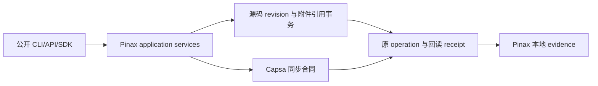

## 范围与 owner

本 change 只负责 Pinax CLI/API/SDK 的工程验收。完整历史实现和原始证据位于 `cli/drivebridge/openspec/handoffs/pinax-drivebridge-workbench-v1/`；消费者 canonical tasks 位于 DriveBridge `drivebridge-desktop-knowledge-reader-v1`，Pinax 不再复制 D 系列状态。

## 验收映射

| 合同 | 现有验证入口 | 预期 |
| --- | --- | --- |
| sync/附件/未知提交 | `go run ./tools/testkit/integrationevidence --profile notebook-backend` | 公开 REST/RPC/SDK 与 ledger 同原 key；丢响应后不重放；附件身份/revision/MIME/引用原子性 |
| 原 operation | `task integration:operation-recovery` | 重启后查询/恢复、冲突、越权与未知结果保持 |
| 日常捕获/整理/阅读 | `go run ./tools/testkit/integrationevidence --profile daily-knowledge` | stdin、保存回读、稳定 ID、只读 review 与恢复 |
| Agent 核心 | `task integration:agent-memory`、`task integration:agent-continuity` | 来源、scope、proposal-only、handoff/feedback/report 合同 |
| 同步/Obsidian/Proof Loop | `go run ./tools/testkit/integrationevidence` | 既有完整本地流程与临时依赖合同 |
| 最终门 | `go run ./tools/testkit/integrationevidence --profile notebook-backend-final` | 单次 `task check`，非 race，Go/lint/build/renderer/OpenSpec |

使用项目原 evidence runner，所有运行成功或失败均保留 `temp/integration-test-runs/<run-id>/` 六件套。失败先归因为 introduced/pre-existing/concurrent/environmental/ambiguous，不为清绿修改别人的代码。无须创建新测试框架或重复相同全量门。

## 接受范围

测试通过只完成本地工程验收。两周日常使用、四周真实 adapter、30 个 continuity loops、真实 Provider 用户复核、macOS/COS/Keychain、真实云写入、三类真实 vault 与任何客户端能力均不由本 change 宣称完成。

兼容结论：只同步文档规格，不改 CLI flag、REST/RPC method、DTO、schema、数据库或旧命令；deprecation window 不变。回退可撤回本次文档/路由变更，运行时和用户资产保持原状。
