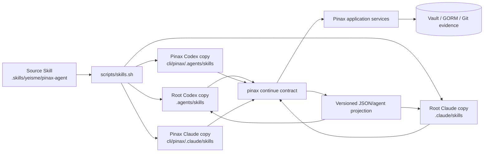
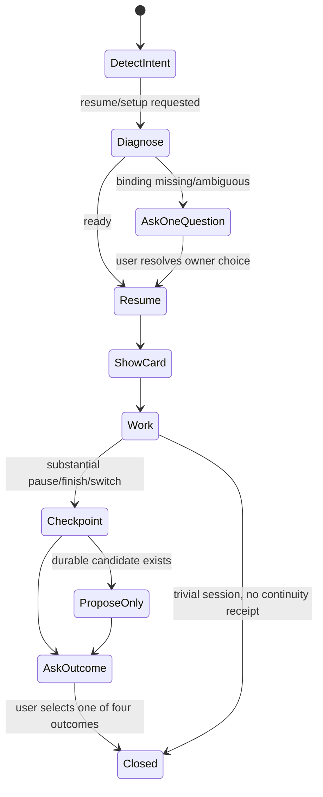

## Context

`cli/pinax` owns canonical continuity state、binding、handoff、proposal/review、receipt 与 report；Codex 和 Claude Code 只需要一个易发现的自然语言入口。若分别编写两套 runtime prompt/skill，触发词、错误恢复、参数和安全边界会快速漂移；若把这些适配逻辑放进 Pinax，则会违反 runtime adapter 外置和 CLI-first owner boundary。

本设计是跨 owner handoff：

- Pinax 实现合同：`cli/pinax/openspec/changes/pinax-trusted-continuity-dogfood-v1/`；
- Root 实现-owning surface：`.skills/yeisme/pinax-agent/pinax-continuity-operator/`、profile assignment 和 generated runtime copies；
- Canonical owner rules：`openspec/specs/agent-memory-owner-routing/spec.md` 与 `openspec/specs/general-agent-memory-contract/spec.md`。

## Goals / Non-Goals

**Goals:**

- 让用户在 Codex 或 Claude Code 中用“继续这个项目”等自然语言触发同一 continuity workflow。
- 用一个 source skill 生成到两个 runtime，保持触发、恢复、checkpoint、review 和 feedback 语义一致。
- 让 missing/ambiguous binding、partial evidence 和 checkpoint failure 以最少打断方式恢复。
- 保持所有 canonical state、权限、source 和 lifecycle 决策在 Pinax。

**Non-Goals:**

- 不在 Skill 内实现 memory store、binding registry、ranking、source resolver 或 review lifecycle。
- 不新增 MCP server、Gateway route、daemon、provider SDK、聊天 bridge 或远程服务。
- 不让 Skill 直接写 `.pinax/**`、vault metadata、JSON/YAML receipts 或数据库。
- 不建设跨项目自动路由、团队协作、公共 onboarding、定价或 client UI。

## Architecture

## Decisions

### 1. 单一 source skill，双 runtime 生成

Source 只存在于 `.skills/yeisme/pinax-agent/pinax-continuity-operator/`。Profile 通过 `scripts/skills.sh profile ...` 更新 root 和 `cli/pinax` 两个 assignment，随后分别生成 root/Pinax 的 `.agents/skills` 与 `.claude/skills`。生成目录不是 source，不允许手工修补 workspace 或 runtime 差异。

替代方案是分别维护 `codex-continuity` 和 `claude-continuity`。该方案会复制 workflow 和安全规则，因此拒绝。Runtime 差异只允许出现在 skill 的兼容 ingress 或 renderer hint，不能改变 Pinax request/response semantics。

### 2. Skill 是交互编排器，不是状态 owner

Skill 只能：

- 识别 resume、status/setup、checkpoint、review 和 feedback 意图；
- 调用真实 Pinax CLI machine mode；
- 将 bounded projection 渲染为简洁对话；
- 在缺少用户决策时提出一个关键问题；
- 在 substantial closeout 后请求四值 outcome。

Skill 不能：

- 读取 Pinax SQLite、registry 或 vault 内部 metadata；
- 生成、修改或确认 canonical memory；
- 根据仓库名猜 vault/scope，或搜索所有 vault；
- 从语气、任务成功或工具日志推断 outcome；
- 把完整聊天或内部推理送入 checkpoint。

### 3. 自然语言 workflow 使用固定状态机

“Substantial”由可观察条件判断：用户在当前 session 完成了实现/调试、产品/spec/docs、release/operations 中至少一项有状态变化的工作，或明确要求暂停/切换 Agent。普通问答、只读查询、失败在 setup 前的尝试不创建 checkpoint 或强制反馈。

### 4. Resume interaction 固定为一张卡和一个下一步

Skill 调用 recorded continue 后，只渲染 Pinax 返回的 objective、last state、key decisions、blockers/conflicts、recommended next action 和 evidence status。它不能重新总结 source body 或添加未经 Pinax 支持的事实。

- success：直接给卡片和一个建议动作；
- partial：保留可信内容，突出 stale/conflict/missing；
- binding missing/ambiguous：只问一个 vault/scope 选择问题或给一个 recovery command；
- CLI unavailable/version mismatch：报告安装/contract blocker，不回退为无来源“记忆”。

### 5. Closeout 使用 checkpoint + proposal-only + explicit outcome

Skill 从本次会话中只提取 bounded objective、current state、decisions、completed work、blockers、verification、follow-ups 和 source refs。若存在长期价值 decision/preference/lesson，它调用 Pinax canonical proposal flow；没有用户 review approval，不得 confirmed。

Checkpoint 成功后，Skill 请求一次四选一 outcome。用户未回答时保持 feedback missing，不反复阻塞当前对话，也不自行填值。`wrong_project` 在 Pinax-only 首轮仍保留为稳定枚举，但报告必须说明不能验证 cross-project routing。

### 6. Weekly review 由同一 Skill 组织，但 mutation 仍归 Pinax

相关 pending item 只在影响当前 next action 时 inline 提示。每周 review 由 Skill 调用 `pinax review` 和 continuity feedback duration contract，目标五分钟内完成。Approve/reject 必须使用 Pinax 返回的 stable item reference、显式确认和 canonical receipt；Skill 不提供自建 bulk approval。

### 7. Compatibility 与 rollout

此 change 只新增 skill directory 和两个 additive profile entries，不重命名任何已发布 skill 或 key。Pinax CLI dependency 必须先通过其 strict OpenSpec validation 和 contract acceptance；未实现的新 command 不得写成当前可用操作。

Rollback：从 root 与 `cli/pinax` profile 移除 `pinax-continuity-operator`，运行 root/target skill sync 与 validation，使四个 generated runtime copies 同时消失；Pinax CLI、vault、binding、handoff 和 receipt data 不删除、不迁移。

## Acceptance Handoff

| Owner | Handoff input | Acceptance output |
| --- | --- | --- |
| `cli/pinax` | provider-neutral bind/status/resume/checkpoint/feedback/report contract | strict-valid child OpenSpec、machine contract examples、fixture smoke evidence |
| root skill owner | accepted Pinax CLI contract | one source skill、profile assignment、Codex/Claude generated copies、validator evidence |
| dogfood operator | both runtime surfaces ready | Pinax-only real loop evidence and weekly reports |

Root change 只验收“两个 runtime 能消费相同 Pinax contract”这一跨 owner 结果，不跟踪 Pinax 内部代码文件、GORM migration 或 package test closeout。

## Risks / Trade-offs

- [Skill 与 CLI contract 同步不及时] → Skill 只消费明确 version/facts；Pinax contract 未 ready 时保持 disabled guidance。
- [两个 generated runtime copy 漂移] → single source + deterministic sync + runtime diff validation。
- [自然语言误触发 checkpoint] → substantial criteria + pause/finish/switch intent；普通问答不写。
- [Skill 在 partial evidence 上过度自信] → 只渲染 Pinax status/warnings，不二次推断。
- [用户厌烦每次反馈] → 只在 substantial recorded loop closeout 请求一次；未答不追问。
- [单仓库成功被外推] → report 和 Skill handoff 固定保留 cross-project unvalidated 标签。

## Migration Plan

1. Pinax child change 固化并验证 machine contract。
2. 用 skill authoring workflow 创建单一 source skill 和 runtime metadata。
3. 通过 profile CLI 将 skill 添加到 root 与 `cli/pinax`，生成两个 workspace 的 Codex/Claude runtime copies。
4. 运行 custom/profile/runtime validators 和 generated-copy diff 检查。
5. 使用 fixture repository 验证 ready、missing binding、partial evidence、checkpoint 和 outcome 流程。
6. 在真实 Pinax repository 开始六周 dogfood；不自动启用其他 repository。

Rollback 按两个 profile remove → root/target sync → validate 执行；不手删生成目录，不改 Pinax canonical state。

## Open Questions

- 第二 repository 选择和跨项目 routing 触发词在 Pinax-only Go 后另立 change 决定。
- 若 Codex 或 Claude Code 后续提供稳定 native lifecycle hook，可作为 Skill 的 optional ingress 评估，但不得改变当前 CLI contract 或自动写入边界。
