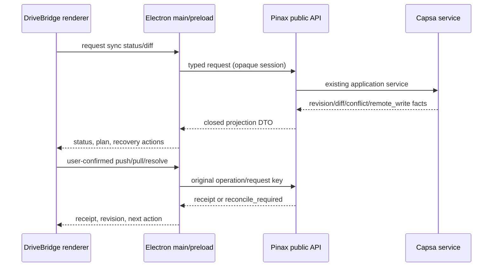

## Owner 与边界

Pinax 是 Markdown vault、对象身份、正文、附件 placement、提案／应用／快照、revision 和 Capsa sync 的唯一 owner。DriveBridge 是消费者和本机体验 owner；它只能调用公开 REST/RPC/typed client contract，不读取 `.pinax/**`、SQLite、绝对路径或 provider payload。Electron main/preload 保存 loopback bearer、文件选择票据和 Pinax session；renderer 只接收闭合 DTO。

本地实现先覆盖合同和 fixture。真实远端 endpoint、跨设备 sync、Mac/Windows/Linux 签名与安装、主力 vault dogfood 仍需独立 owner 证据。

## Sync control flow

`sync.status` 和 `sync.diff` 是只读计划面；`sync.push`、`sync.pull`、`sync.conflicts.resolve` 继续要求 owner write gate 与显式确认。`remote_write=true` 只有在远端 durable commit、返回 revision 且本地 read-back 成功后才能由 Pinax 产生。DriveBridge 的文件上传、hydrate 或本地 projection 不得更新 Capsa revision。

## Notebook workbench

工作台状态机是纯状态转换：

`bound → reading → draft → preview → applying → succeeded | conflict | unknown | revoked`

草稿只在 renderer 内存中存在；恢复槽只保存 opaque operation key。任何 rich/composed 预览都带 `source_anchor`、`origin`、固定 `revision` 和嵌入状态。嵌入目标必须单独打开和授权；cycle、unavailable、depth limit、unsupported 和不安全映射都成为明确状态。编辑只提交原 Markdown source 的 proposal，不接受 composed projection 或 renderer 路径写入。

附件使用现有 inputrequests 临时输入合同：Pinax 校验 MIME/大小、placement、固定 note identity、revision guard、快照、正文引用更新和 receipt。DriveBridge 不把本机路径或任意文件句柄传给 renderer API。

## 当前交付与限制

### 全部未完成规格的推进目标（2026-10-24）

持续 goal 覆盖本 change、`pinax-passphrase-s3-bootstrap`、`pinax-daily-knowledge-loop-v1`、`pinax-real-judgment-acceptance-v1`、`pinax-trusted-continuity-dogfood-v1`、`pinax-agent-memory-runtime` 及必要的 DriveBridge 消费者依赖。Pinax 能力属于 `fit`；Electron、managed-vault 和消费者会话属于 `split-owner`，实现与验收记录留在 `cli/drivebridge`。各 change 的 `tasks.md` 保持进度真源；本节只定义推进顺序，不复制另一套任务状态。

先完成 R01 工程质量门：对已有失败按当前规范归因，保留兼容、安全、原操作恢复和完整用户流程覆盖，先运行定向检查，再运行完整非 race 门禁。新增窄屏输出错误传播回归，修正旧 CLI 帮助、资源列和补全协议断言。Pinax 与 DriveBridge 都通过各自要求后才关闭 R01。

随后完成 D03/D08 的保护方案和可丢弃环境证明，再连接 D14.3 的真实 Electron 编辑纵切。旧 writer、独立 state、已有句柄、别名与 ancestor rename/delete 必须进入保护反例矩阵；registry 字段和 UI 禁用按钮不能作为 guard 证明。系统权限变更、服务安装和真实用户数据迁移须先形成可审查方案，再取得具体动作授权。不得用私有 vault 副本悄悄替换用户工作流。

DriveBridge D03.4 已完成未接产品的 Linux state 栅栏组件：原 process lock、目录身份与 source revision 复验、持久原数据库快照和原子格式标记、五个真实进程中断点及原 migration identity 恢复。`fenced` 只表示维护布局，不授予 guard/binding/session；跨 state/旧 release/Server 构造与应用保护域仍需后续验收。实现与证据真源为 `cli/drivebridge/openspec/changes/drivebridge-desktop-knowledge-reader-v1/state-fence-protocol.md` 和该 owner 的 D03.4/D03.5 任务，Pinax D03/D08 不提前关闭。

关联 handoff 也纳入持续盘点：`pinax-continuity-operator-handoff-v1` 当前剩余 4.1 跨 runtime 真使用验收、4.2 closeout。其任务声明的 owner 为根仓 Skill/profile 治理，依赖 continuity 的真实报告和 Go/Iterate/Stop 回执；不将这两项当作 Pinax 核心代码缺口，也不以工程检查代填完成。执行期间如出现其他 active change，先核对 owner 与依赖再纳入，保留并行修改。

本地链路成立后，R02 与 S3 7.5–7.9 收集真实云 endpoint、跨设备收敛、macOS release candidate/Keychain、恢复矩阵和平台支持证据。真实外部写入与发布按具体目标授权；本地 mock、交叉编译或 Linux 运行不代替这些门槛。

R03、daily 7.1、judgment 1.3、continuity 8.3–8.4 与 memory 8.5–8.6 复用各自已有工具和原始证据：两周主力使用、真实案例用户复核、至少 30 次 substantial loops、两种 runtime/三类任务及四周 adapter/Codex 使用观察。可以核对已有记录，不能生成用户 outcome、补写不存在的使用记录或用自然时间流逝证明验收。缺项保持 open。

最终完成各 owner 任务回填、规格同步和 closeout；只有全部必需验收满足，持续 goal 才完成。自然观察、平台与用户决策门尚未满足时，优先继续独立的可执行工程项；无可执行项后明确报告所缺证据。

工程门补充覆盖 operation lock 初始化窗口：`O_EXCL` 创建路径后 JSON 尚未写完时，竞争者必须得到 `lock_held`，保留原文件，不将空或损坏元数据视为 stale。确定性空/截断/类型错误用例和已有协作并发保存、过期锁恢复共同验证此合同。该修复只规范失败闭锁行为，不代表重构了现有 TTL 与 stale 回收策略；永久损坏的锁仍需核实原操作后恢复。

本变更已实现 Pinax sync control 的公开注册、REST/RPC handler、schema、typed client 和公开 push/pull/conflicts.resolve 的通用 operation ledger 绑定；原 identity 可通过 sync receipt 完成跨进程 reconcile。附件采用沿用显式启用的 MCP input surface，公开 typed DTO/schema 位于 `pkg/inputcontract`，新增／替换经过固定 identity、完整 revision、snapshot、原子引用更新和 receipt；不新增附件 REST/RPC 端点。详细边界和矩阵见 `docs/interfaces/notebook-backend-recovery-and-attachments.md`。DriveBridge 的 writer/sync contract generator 已于 2026-10-23 从当前 owner export 重新生成并通过漂移门；纯状态机补齐页面内草稿、原 key 终态恢复和撤权清空，只读 Sync 面板通过 fixture 浏览器组件验收。2026-10-24 独立 opaque recovery slot 复用 notebook Web Locks/storage，在 actor/source/binding 隔离槽中只保存原 key，跨 reload 回读与 CAS 清理通过真实浏览器组件测试；本 spec 的纯状态机/草稿/恢复槽 D14.2 完成。完整 writer/preload 与真实宿主集成仍属于 DriveBridge D14.2 父项和 D14.3，保持未完成。D03/D08 保护域和 D14.3 真实 Electron 纵切只有在宿主 guard、可丢弃 vault 和进程证据齐备后才可勾选。
