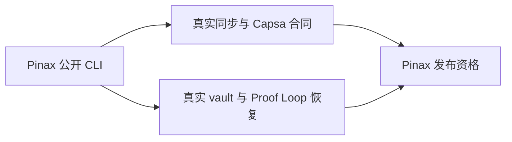

## Owner 与接受条件

本 change 属于 `cli/pinax`。原 workbench 历史包归 `cli/drivebridge/openspec/handoffs/pinax-drivebridge-workbench-v1/`；客户端 canonical 执行位于 DriveBridge 的 `drivebridge-desktop-knowledge-reader-v1`。历史 R03 的“release closeout”在这里仅指 Pinax CLI，不含客户端平台、签名、guard 或 UI。

## 依赖与下一次执行

| 任务 | 依赖与范围 | 通过所需证据 | 失败处理 |
| --- | --- | --- | --- |
| R02 | 已就绪同步合同、具体 endpoint 和第二设备 | device bind/push/pull/conflict 合同、durable revision/read-back、两设备收敛；复用 `task integration:sync-real` 与已有 sync CLI | 无 endpoint/凭据/授权则 `pending`；unknown 先查原 operation，禁止新 key 重提 |
| R03 | 用户指定三类真实 Obsidian vault，授权的 snapshot/repair/restore 范围 | 结构/规模/兼容差异、两周主力使用、snapshot/apply/restore 回读与 Pinax closeout | 缺真实样本或使用反馈则保持未测；先在可丢弃数据验证，不修改真实 vault |

R02 与 `pinax-passphrase-s3-bootstrap` 7.5–7.9 可共享同一真实运行的证据，但 macOS/Keychain 支持等级仍由原任务裁定；fixture、Linux 本地远端和交叉编译不能关闭它。R03 与 daily knowledge/daily interaction 可在相同主力 vault 同一真实窗口采集一次，分别按各自指标报告；不要求重复使用两遍，也不能替代 continuity 或 memory 的分母。

本地准备验证可运行 `go run ./tools/testkit/integrationevidence`；这是现有 default profile，含 Obsidian、Proof Loop restore、两端模拟同步和 Capsa client 合同。它只证明工程合同，不勾选 R02/R03。验收与 CLI 命令以当前 `--help` 为准。

不自动重启过期的观察窗口，不每天重复本地测试作为“进展”。新真实证据到达时才通过根仓 `scripts/openspec-tasks.py set` 更新本 change；用户反馈由用户给出，不从成功退出码推断。
