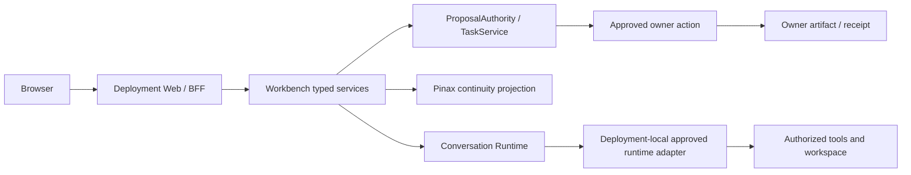

## Context

本设计承接 2026-09-05 的用户决定：个人高频通用 Agent、项目与成果优先、授权范围内自主推进、桌面 Web、同一 C/S 产品在部署端使用工具。具体产品与 UI 真源位于 Workbench 子项目；本文件只定义跨项目权威和 handoff。

已有 `agent-conversation-runtime-workbench-integration-v1` 定义 Conversation Runtime、Runtime Plane、Workbench、Pinax 与执行 owner 的分工；已有 Pinax trusted continuity 定义 bounded handoff、来源核验、proposal/review。两者仍是复用基础。本 change 不把这些基础描述成已完成的真实 provider 接入。

## Goals / Non-Goals

**Goals:** 让同一个项目跨会话、工具与重启继续工作；客户端展示可核验来源和成果；允许独立 action grant 支持范围内连续执行；本地与远程部署复用相同语义。

**Non-Goals:** 不引入跨部署 agent、同步服务、新 memory/文件 owner；不代替子项目编写实现日志；不建立 remote repo 或部署线上服务；不以新设计关闭既有专业能力。

## Decisions

### 1. 部署端执行，同源客户端

Web 地址定位一个部署实例。服务部署在本机、服务器或容器时，工具和授权目录都属于该部署的执行边界。Runtime Plane 的 loopback 合同保持 loopback，由部署端 BFF/服务访问；不能因为浏览器在远程而把 broker 直接暴露公网。浏览器上传只能经 owner 导入动作形成 safe ref，不能用路径字符串暗示已访问用户电脑。

对比过的路径：一套服务栈在不同位置运行满足当前要求；云端控制本地 agent 与自动同步增加连接/权限模型，当前不实施；全量内嵌所有领域服务会复制 owner，拒绝。

### 2. 项目关联与连续性是组合合同

| 数据/行为 | 唯一权威 | Workbench 可持有 |
|---|---|---|
| Project、工作目录、正文和媒体 | 已批准项目/运行时/领域 owner | opaque project/workspace/artifact refs、版本和安全摘要 |
| 项目布局、最近打开对象、目录组合 | Workbench | 用户范围内的安全 UI metadata |
| 会话正文、运行时摘要 | Conversation Runtime | 授权内容投影与 refs，不复制 content DB |
| 长期决定、continuity pack、source conflict | Pinax | 有时效的安全投影；不裁定 confirmed memory |
| Run、Task、proposal、批授权准入 | 原 Runtime、TaskService、ProposalAuthority | 原合同指定的 metadata、事件与 receipt |
| 多 Agent 调度、writer lease、Team | 执行 owner（原 owner 已退役） | typed plan/run/receipt 投影 |

已有 safe `projectRef` 是关联锚点；Workbench `ProjectWorkspace` 不能变成第二个 canonical Project。Pinax binding 缺失或歧义时必须明确恢复，不按目录名、最近会话或标题猜 scope。未关联 Pinax 的项目仍可浏览已有会话和成果，但不能声称提供可信续接。

打开项目仅恢复视图。用户触发“继续”后，消费方重新验证 sources/revisions、binding、principal、active attempts 和 grant；运行尚在执行时附着原运行，结果未知时只对账，旧运行终结后才可经明确入口开始新回合。换 Runtime 产生同项目的新 session，不自动转换原始 transcript 或重放工具。

### 3. 独立 action grant 不改写旧 grant

规划新 pre-1.0 合同 `workbench.bounded_action_grant.v1alpha1`。ProposalAuthority 拥有用户对批授权 proposal 的决定和撤销记录；Runtime/工具 owner 负责自身效果、资源和实际执行权威。有效范围是 Identity、项目策略、Runtime grant、action grant 与 owner policy 的交集。

用户确认必须绑定：主体/租户/项目、目标资源或受控资源集、owner 声明的 operation/effect class、Profile/manifest revisions、预算与次数上限、有效期。授权不得包含任意 executable/argv/env、路径或客户端自报“低风险”事实。

每个工具动作仍生成 owner-authored proposal；服务端在 dispatch 前校验 grant、resource revision、policy、budget reservation、idempotency 和必要 writer lease。若先前批准可以满足该 proposal，记录 grant 与 decision receipt 的关联再进入 TaskService；浏览器不能生成批准事实或自动点击确认。

通用终端命令不因位于项目目录就成为低风险。只有 owner 明确声明、限制效果并验证过的操作/recipe 才能纳入批授权；不可判定的命令、任意脚本、敏感读取、对外写、删除不可丢弃数据、发布和权限/模型/工具范围升级继续单独审批。领域 Canon 晋级仍遵循原 owner 人工权威。

撤销/到期阻止新 dispatch；已 accepted 的工作由原 owner 执行 cancel/reconcile，不能伪造撤销即已取消。并发预算必须原子预留，未知结果的预留不直接释放；不能重复开始同一操作来绕过次数或预算。

### 4. Provider packet 与交付依赖

实施前，由各 owner 提供 CLI/服务生成的 provider packet：合同 identity/version/digest、支持动作及 effects、scope/revision、cursor、cancel/reconcile、receipt、错误/恢复语义、availability、固定调用入口和脱敏证据引用。没有 packet 的动作保持 `needs_contract`，UI fixture 只用于布局和合同测试。

| Owner | 现有依据/实现落点 | 本计划 handoff | 依赖状态 |
|---|---|---|---|
| Workbench | `workbench-project-continuity-desktop-v1`（已退役 Workbench change） | 项目续接/桌面 UI/consumer grant/部署验收 | 规划包已建立，实施 pending |
| Pinax | `cli/pinax/openspec/changes/pinax-trusted-continuity-dogfood-v1/`；`cli/pinax/docs/product/trusted-agent-continuity.md` | 核验 existing compile/binding/source/review 是否可由 typed facade 消费；缺项在 Pinax 新建 `pinax-workbench-continuity-projection-v1` | 待 provider packet；目标新 change 尚未创建 |
| Conversation Runtime | 根 `agent-conversation-runtime-workbench-integration-v1` 的 owner/bootstrap/protocol handoff | 会话续接、deployment workspace safe refs、独立 action grant 验证 | 沿用未来 owner 建立门；不由 Workbench 替代 |
| Runtime Plane | `backend-server/client-runtime/`；既有 `aigora-agent-access-binding-v1` | 固定 adapter/run/events/cancel/reconcile，新增 Conversation adapter 仍走原 root handoff | 待独立合同；Aigora ready 不代表 Agent ready |
| Artifact owner | 选中场景的现有领域项目 | 预览/版本/导出/receipt，provider 自己保存字节 | 逐 owner/operation 判定 |
| 执行 owner / Identity | 既有 owner 合同 | Team/writer lease 与身份撤销，各自权威保持不变 | 当前不新增调度或身份产品（执行 owner 侧已随退役冻结） |

根任务只负责合同、routing、文档索引与 handoff 确认。后续缺失 owner change 的创建和实现由对应项目承接；根只接收紧凑 verdict，不复制 implementation tasks 或完整日志。

## Risks / Trade-offs

- [正文或目录通过 continuity 泄漏] → provider 投影最小化；binding/读取逐次授权；客户端不持有 private path、credential 或 transcript dumps。
- [模型摘要被当正式决定] → Runtime summary 与 Pinax confirmed decision 分层；保留 sources/conflict；记忆晋级只走 Pinax。
- [批授权扩大既有权限] → 独立 identity、显式 opt-in、默认关闭、owner effect allowlist 与逐 action 验证；旧 grant 原义不变。
- [UI 已完成但核心 runtime 缺失] → provider、consumer、真实 canary、部署验证分别判定；缺一不得整体晋级。
- [所有场景都要求一次交付] → 共同内核先完成，专业场景按 evidence 晋级；用户要求与已承诺能力保留在 ledger。

## Migration Plan

先冻结新增合同和 provider packets，再在 Workbench 独立 capability 下接入。现有 APIs、routes、references、grant 和 receipt 不删除、不重命名；新增字段只能 optional 或独立 versioned projection。代码和数据库变更分别由 owner OpenSpec 管理，GORM/Drizzle 遵循各自项目规定。

`breaking_surfaces: []`；本次不宣布 deprecated surface，也不安排移除旧入口。回滚关闭新增 capability 并停止新 action grant 的签发/准入，继续保留已 accepted 工作的原查询、cancel/reconcile 和 receipt。不能删除 owner 数据或清空历史任务实现回滚。

## Open Questions / Evidence Gates

产品与部署选择已确定。Pinax 可消费 packet、真实 Conversation provider、action effects 安全分类和桌面原型可用性属于有 owner 的验证门，不由实现者猜测。用户没有提供实际任务样本，Workbench 以明确标注的场景实验完成后再判断使用价值。
